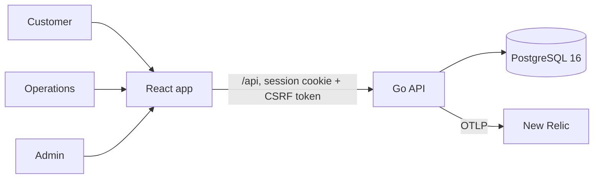

# Bank App: Online Banking Mini Application

A security-first online banking system. Customers view accounts, manage beneficiaries, make internal fund transfers and read their statements. Operations users review and freeze accounts they have been assigned. A single administrator manages users, account assignments, the transfer limit and the audit trail.

The backend is Go (Gin, pgx, PostgreSQL). The frontend is React (Vite, Tailwind, JavaScript). Every protected operation is authorised on the backend, money moves atomically, and every sensitive action is audited.

## How it fits together



## Documentation map

Read in this order if you are new: architecture, design, then the rest as needed.

| Document | What it answers |
|---|---|
| [architecture.md](architecture.md) | How the system is structured: layers, middleware chain, request lifecycle (Mermaid diagrams) |
| [design.md](design.md) | Why it is built this way: design decisions, trade-offs, failure modes, scaling limits |
| [api.md](api.md) | Every endpoint, request and response shape, error codes, examples |
| [database.md](database.md) | ER diagram, tables, constraints, migrations, seed data |
| [transfer_lifecycle.md](transfer_lifecycle.md) | How a transfer executes, idempotency, review and freeze lifecycles |
| [security.md](security.md) | Defence layers, threat-to-control map, OWASP API Top 10 mapping, known gaps |
| [tests.md](tests.md) | Test strategy, how to run every suite, coverage map, gaps |
| [observability.md](observability.md) | Logging, tracing, metrics, New Relic setup, health checks, graceful shutdown |
| [workflow.md](workflow.md) | Git and PR workflow, CI pipeline, how to add an endpoint, migration rules |
| [deployment.md](deployment.md) | Configuration reference, run instructions, production checklist |
| [changelog_and_status.md](changelog_and_status.md) | What is done, what is known to be missing, roadmap |

The interactive API reference is generated from code annotations and served at `http://localhost:8080/swagger/index.html` when `SWAGGER_ENABLED=true`.

## Tech stack

| Layer | Technology |
|---|---|
| Backend | Go 1.26 (see `backend/go.mod`), Gin 1.12, pgx v5 (raw SQL, no ORM), Argon2id (`x/crypto`), swaggo for OpenAPI |
| Database | PostgreSQL 16, schema managed by golang-migrate |
| Frontend | React 18, React Router 6, Vite 5, Tailwind CSS 3, Vitest (JavaScript, not TypeScript) |
| Observability | `log/slog` JSON logs, OpenTelemetry traces and metrics (otelgin, otelpgx), New Relic via OTLP |
| CI | GitHub Actions (vet, build, migrations, race-enabled tests, migration rollback round trip) |

## Prerequisites

- Docker (for PostgreSQL)
- Go matching `backend/go.mod`
- The [golang-migrate](https://github.com/golang-migrate/migrate) CLI with the `postgres` driver
- Node.js 18 or newer

## Quick start

```sh
cp -n .env.example .env
make db-up          # PostgreSQL in Docker
make migrate-up     # apply schema and seed data
make run            # Go API on :8080
```

```sh
cd frontend
npm install
npm run dev         # React app on http://localhost:5173 (proxies /api to :8080)
```

Check it is alive: `curl -s localhost:8080/health` and `curl -s localhost:8080/ready`.

Useful commands:

| Command | Does |
|---|---|
| `make test` | Backend tests (database suites skip unless `TEST_DATABASE_URL` is set, see [tests.md](tests.md)) |
| `cd frontend && npm test` | Frontend tests |
| `cd backend && make swagger` | Regenerate the OpenAPI docs |
| `make migrate-down` | Roll back one migration |
| `make db-down` | Stop PostgreSQL |

## Demo credentials (local development only)

| Role | Username | Password |
|---|---|---|
| Admin | `demo-admin` | `DemoAdminPassword123!` |
| Operations | `demo-operations` | `DemoOperationsPassword123!` |
| Customer | `demo-customer` | `DemoCustomerPassword123!` |
| Customer | `demo-customer-b` | `DemoCustomerPassword123!` |

These are seeded by migration `001_init`. **Remove them before any real deployment** (see [deployment.md](deployment.md)).

## Roles at a glance

| Role | Can | Cannot |
|---|---|---|
| **Customer** | See own accounts and statements, manage own beneficiaries, transfer from own accounts | See anyone else's data, use admin or operations endpoints |
| **Operations** | See accounts assigned to them, review transfers touching those accounts, freeze or unfreeze them | Move money, change balances, see unassigned accounts, manage users |
| **Administrator** (exactly one, seeded) | Create and manage users, assign accounts to operations users, set the transfer limit, search the audit log | Read customer financial data, be deactivated or demoted through the API |

## Repository layout

```
backend/
  cmd/server/            entry point: wiring, routes, graceful shutdown
  cmd/hashpw/            prints an Argon2id hash for a password
  config/                environment configuration
  database/              pgx connection pool (with tracing)
  internal/
    account/ admin/ auth/ beneficiary/ operations/ transfer/   feature packages (handler, service, models)
    apperr/ httpx/ validate/ audit/ telemetry/ middleware/      shared building blocks
  repository/            all SQL lives here
  migrations/            001_init, 002_create_transaction_limits
  docs/                  generated OpenAPI (swagger.yaml)
  tests/                 api, integration, security suites
frontend/                React app (src/pages by role: customer, ops, admin)
docs/                    this documentation
.github/workflows/       CI
.devcontainer/           dev container
docker-compose.yml       local PostgreSQL
Makefile                 db, migrate, run and test shortcuts
```

## Team

| Name | Role / contribution |
|---|---|
| Guruprakash P | _fill in_ |
| Harshatha Rithika | _fill in_ |
