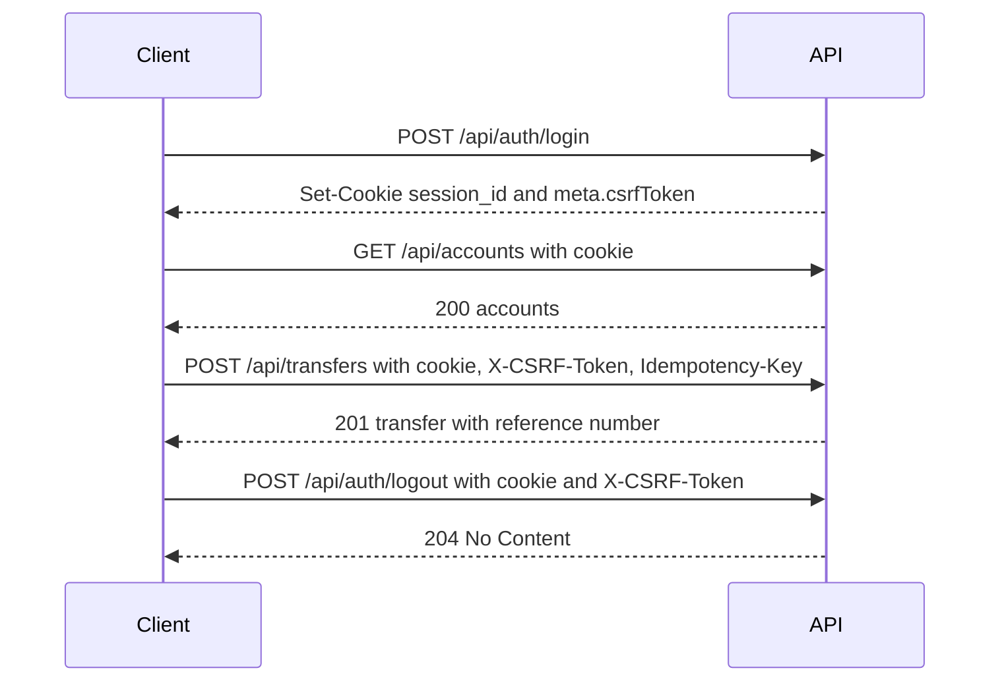

# API Reference

> **In one minute:** JSON over HTTP under `/api`. Log in to get a session cookie and a CSRF token. Send the cookie on every call and the CSRF token on every write. Money is a string like `"5000.00"`. Transfers need an `Idempotency-Key`.

Base URL: `/api` (local: `http://localhost:8080/api`). Interactive docs: `/swagger/index.html` (when `SWAGGER_ENABLED=true`). The OpenAPI file is `backend/docs/swagger.yaml`, regenerated with `make swagger` from `backend/`.

## 1. Typical flow



## 2. Conventions

### Authentication
Session cookie `session_id` (HttpOnly, Secure, SameSite=Strict), set by `POST /api/auth/login`.

```
Cookie: session_id=<random-session-id>
```

### CSRF
`POST`, `PATCH` and `DELETE` (except login and signup) require the header `X-CSRF-Token`. The token is returned in `meta.csrfToken` by login and by `GET /api/me`.

### Success envelope
```json
{ "data": { }, "meta": { "correlationId": "uuid" } }
```
List endpoints add `page`, `pageSize`, `totalItems`, `totalPages` to `meta`.

### Error envelope
```json
{ "error": { "code": "INSUFFICIENT_FUNDS", "message": "Insufficient funds.", "correlationId": "uuid" } }
```
Validation errors add field messages:
```json
{ "error": { "code": "VALIDATION_ERROR", "message": "Request validation failed.",
             "fields": { "amount": "must be positive with at most 2 decimal places" }, "correlationId": "uuid" } }
```
Errors never contain SQL, stack traces, hostnames, file paths, session internals or password hashes. Quote the `correlationId` when reporting a problem. It is also returned in the `X-Correlation-ID` response header, A client may send its own `X-Correlation-ID` request header, but it is used only if it is a valid UUID, otherwise a new one is generated.

> Known inconsistency: errors produced by the authentication, CSRF and rate-limit middleware, and by the auth handlers, put `correlationId` under `meta` instead of inside `error`. Clients should read it from either place. See [changelog_and_status.md](changelog_and_status.md).

### Money
Amounts are decimal strings with exactly two places (`"5000.00"`), currency `INR`. Never floats.

### Pagination
`page` (default 1, minimum 1) and `pageSize` (default 20 for customer and operations lists, 25 for admin users and audit, maximum 100). An out-of-range value returns `400 VALIDATION_ERROR`.

### Idempotency
`POST /api/transfers` requires `Idempotency-Key` (16 to 100 characters of `A-Z a-z 0-9 _ -`). Repeating a request with the same key and the same payload returns the original transfer. The same key with a different payload returns `409 IDEMPOTENCY_CONFLICT`. Keys are scoped per user.

### Request hygiene
`Content-Type: application/json` required (415 otherwise), body limit 64 KB (413), **unknown fields are rejected** (400), and only one JSON value is accepted.

### Rate limits

| Endpoint | Key | Limit |
|---|---|---|
| `POST /api/auth/login` | IP + username, and IP alone | 5 per minute, and 20 per minute |
| `POST /api/auth/signup` | IP | 5 per minute |
| `POST /api/transfers` | user | `TRANSFER_RATE_LIMIT` per minute (default 10) |

Over the limit: `429 RATE_LIMITED` with a `Retry-After` header (seconds).

## 3. Roles

| Area | Customer | Operations | Admin | Public |
|---|:-:|:-:|:-:|:-:|
| Health, ready, swagger | | | | yes |
| Signup, login | | | | yes |
| Logout, me | yes | yes | yes | |
| Accounts, beneficiaries, own transfers | yes | | | |
| Transfer lookup by reference | own | assigned scope | 403 | |
| `/operations/*` | | yes | | |
| `/admin/*` | | | yes | |

A wrong role gets `403 FORBIDDEN` and an `ACCESS_DENIED` audit event.

## 4. Error codes

| HTTP | Code | Meaning |
|---|---|---|
| 400 | `INVALID_REQUEST` | Malformed JSON, unknown field, or trailing data |
| 400 | `VALIDATION_ERROR` | Field-level validation failed (see `fields`) |
| 401 | `UNAUTHENTICATED` | Missing, forged, expired or revoked session |
| 401 | `INVALID_CREDENTIALS` | Login failed (identical for unknown user, wrong password, deactivated user) |
| 403 | `FORBIDDEN` | Authenticated but wrong role |
| 403 | `CSRF_INVALID` | Missing or invalid `X-CSRF-Token` |
| 404 | `NOT_FOUND` | Missing, not yours, or out of your scope (deliberately indistinguishable) |
| 409 | `USERNAME_TAKEN`, `DUPLICATE_BENEFICIARY`, `ASSIGNMENT_EXISTS`, `IDEMPOTENCY_CONFLICT` | State or duplicate conflict |
| 413 | `PAYLOAD_TOO_LARGE` | Body over 64 KB |
| 415 | `UNSUPPORTED_MEDIA_TYPE` | Not `application/json` |
| 422 | `INSUFFICIENT_FUNDS`, `ACCOUNT_FROZEN`, `BENEFICIARY_INACTIVE`, `TRANSFER_LIMIT_EXCEEDED` | Valid request, business rule failed |
| 422 | `PROTECTED_USER`, `INVALID_ROLE_CHANGE`, `INVALID_ASSIGNMENT` | Admin operation not allowed |
| 429 | `RATE_LIMITED` | Too many requests, see `Retry-After` |
| 500 | `INTERNAL_ERROR` | Unexpected failure, generic message only |

## 5. Operational endpoints (no auth)

| Method | Path | Purpose |
|---|---|---|
| GET | `/health` | Liveness: `{"status":"ok"}` |
| GET | `/ready` | Readiness: 200 `{"status":"ready"}` when the DB answers and the server is not draining, else 503 `{"status":"unavailable"}` |
| GET | `/swagger/*any` | Swagger UI (not registered when `SWAGGER_ENABLED=false`) |

These three paths are outside `/api`.

## 6. Authentication

| Method | Path | Notes |
|---|---|---|
| POST | `/api/auth/signup` | Public, rate limited. Always creates a `CUSTOMER` with no bank account. Body: `username`, `password` (min 12), `fullName`. 201 `data.user`. 409 `USERNAME_TAKEN`. |
| POST | `/api/auth/login` | Public, rate limited. Sets the cookie. 200 `data.user` and `meta.csrfToken`. |
| POST | `/api/auth/logout` | Session + CSRF. Deletes the session. 204. |
| GET | `/api/me` | Session. `data` = `id`, `username`, `role`; `meta.csrfToken`. |

```sh
curl -i -c jar.txt -X POST http://localhost:8080/api/auth/login \
  -H 'Content-Type: application/json' \
  -d '{"username":"demo-customer","password":"DemoCustomerPassword123!"}'
```
```json
{ "data": { "user": { "id": "uuid", "username": "demo-customer", "role": "CUSTOMER" } },
  "meta": { "correlationId": "uuid", "csrfToken": "base64url-token" } }
```
Because the cookie is `Secure`, browsers accept it on `localhost`, but some HTTP clients will not send it back over plain HTTP.

## 7. Customer endpoints (role `CUSTOMER`)

### Accounts
| Method | Path | Notes |
|---|---|---|
| GET | `/api/accounts` | Own accounts |
| GET | `/api/accounts/{accountId}` | 404 if not yours |
| GET | `/api/accounts/{accountId}/transactions` | Filters below |

Account: `id`, `accountNumberMasked` (`******1234`), `accountType` (`SAVINGS` or `CURRENT`), `balance`, `currency`, `status` (`ACTIVE` or `FROZEN`).

Transaction query parameters: `type` (`DEBIT` or `CREDIT`), `from`, `to` (RFC 3339), `minAmount`, `maxAmount`, `sort` (`createdAt`, `amount`, `type`), `direction` (`ASC` or `DESC`), `page`, `pageSize`. Sort and direction are matched against fixed allow-lists and never concatenated from input.

```
GET /api/accounts/{id}/transactions?type=DEBIT&sort=createdAt&direction=DESC&page=1&pageSize=20
```
Transaction: `id`, `type`, `amount`, `currency`, `description`, `balanceAfter`, `createdAt`.

### Beneficiaries
| Method | Path | Body | Notes |
|---|---|---|---|
| POST | `/api/beneficiaries` | `destinationAccountId`, `nickname` | 201. 404 if the account is missing or your own. 409 `DUPLICATE_BENEFICIARY`. |
| GET | `/api/beneficiaries` | | Own only |
| PATCH | `/api/beneficiaries/{beneficiaryId}/status` | `status`: `ACTIVE` or `DEACTIVATED` | 404 if not yours |

Beneficiary: `id`, `destinationAccountId`, `destinationAccountMasked`, `nickname`, `status`.

### Transfers
| Method | Path | Notes |
|---|---|---|
| POST | `/api/transfers` | Session + CSRF + `Idempotency-Key`, per-user rate limit |
| GET | `/api/transfers` | Transfers the customer initiated, newest first |
| GET | `/api/transfers/{referenceNumber}` | Customer: own. Operations: within assigned scope. Admin: 403. Otherwise 404. |

```json
POST /api/transfers
Headers: Idempotency-Key: rent-2026-10-a1b2c3d4, X-CSRF-Token: <token>
{ "sourceAccountId": "uuid", "destinationAccountId": "uuid",
  "beneficiaryId": "uuid (optional)", "amount": "5000.00", "purpose": "Rent payment" }
```
```json
201 { "data": { "referenceNumber": "TRF-9F3A1C0B7D2E4A55", "sourceAccountId": "uuid",
        "destinationAccountId": "uuid", "destinationAccountMasked": "******9876",
        "amount": "5000.00", "currency": "INR", "purpose": "Rent payment",
        "status": "COMPLETED", "reviewStatus": "NONE", "createdAt": "2026-10-04T10:30:00Z" },
      "meta": { "correlationId": "uuid" } }
```
`beneficiaryId` is omitted from the response when none was used. Rules and the failure matrix: [transfer_lifecycle.md](transfer_lifecycle.md).

## 8. Operations endpoints (role `OPERATIONS`)

Everything is scoped to accounts explicitly assigned to the caller. Out-of-scope objects return `404` and write an `ACCESS_DENIED` audit event.

| Method | Path | Notes |
|---|---|---|
| GET | `/api/operations/accounts` | Assigned accounts, masked numbers |
| GET | `/api/operations/accounts/{accountId}/transactions` | Same filters as the customer version |
| GET | `/api/operations/transfers` | Filters: `reference`, `status` (`PENDING`, `COMPLETED`, `FAILED`), `reviewStatus` (`NONE`, `UNDER_REVIEW`, `RESOLVED`), `dateFrom`, `dateTo`, `page`, `pageSize` |
| PATCH | `/api/operations/transfers/{reference}/review` | Body `{"reviewStatus":"UNDER_REVIEW"}` or `"RESOLVED"`. Audited with old and new value. |
| POST | `/api/operations/accounts/{accountId}/freeze` | 200 with the account. Idempotent. Audited on change. |
| POST | `/api/operations/accounts/{accountId}/unfreeze` | Same |

Operations transfer: `referenceNumber`, `sourceAccountId`, `destinationAccountId`, `destinationAccountMasked`, `amount`, `currency`, `purpose`, `status`, `reviewStatus`, `createdAt`.

## 9. Admin endpoints (role `ADMIN`)

| Method | Path | Body or query | Result |
|---|---|---|---|
| POST | `/api/admin/users` | `username`, `role` (`CUSTOMER` or `OPERATIONS`), `temporaryPassword`, `fullName` (required for `CUSTOMER`) | 201 user, force-password-change flag set |
| GET | `/api/admin/users` | `search`, `role`, `status`, `page`, `pageSize` | Paginated users: `id`, `username`, `role`, `status`, `createdAt` |
| PATCH | `/api/admin/users/{userId}/status` | `status`: `ACTIVE` or `DEACTIVATED` | 200 `{id,status}`, deactivation deletes sessions |
| PATCH | `/api/admin/users/{userId}/role` | `role`: `CUSTOMER` or `OPERATIONS` | 200 `{id,role}`, deletes sessions and, if leaving OPERATIONS, assignments |
| POST | `/api/admin/users/{userId}/reset-password` | `newPassword` (min 12, max 128) | 204, deletes sessions. The password value is never logged or stored in audit metadata |
| POST | `/api/admin/account-assignments` | `operationsUserId`, `accountId` | 201, 409 `ASSIGNMENT_EXISTS`, 422 `INVALID_ASSIGNMENT` |
| GET | `/api/admin/config/transaction-limit` | | `currency`, `maxTransferAmount` |
| PATCH | `/api/admin/config/transaction-limit` | `maxTransferAmount` | 200, audited with old and new value |
| GET | `/api/admin/audit-events` | `eventType`, `actorUserId`, `entityType`, `entityId`, `result`, `from`, `to`, `page`, `pageSize` | Paginated events |

Protections: the `ADMIN` role can never be granted, and the admin account cannot be deactivated, demoted or password-reset through the API (`422 PROTECTED_USER`).

Audit event: `id`, `actorUserId`, `eventType`, `entityType`, `entityId`, `action`, `result`, `ipAddress`, `correlationId`, `metadata`, `createdAt`.

Audit event types in use: `LOGIN_SUCCESS`, `LOGIN_FAILURE`, `LOGOUT`, `ACCESS_DENIED`, `RATE_LIMITED`, `BENEFICIARY_CREATED`, `BENEFICIARY_DEACTIVATED`, `TRANSFER_COMPLETED`, `TRANSFER_FAILED`, `TRANSFER_REVIEWED`, `ACCOUNT_FROZEN`, `ACCOUNT_UNFROZEN`, `USER_CREATED`, `USER_STATUS_CHANGED`, `USER_ROLE_CHANGED`, `USER_PASSWORD_RESET`, `ACCOUNT_ASSIGNED`, `TRANSACTION_LIMIT_CHANGED`.

## 10. Status codes used

`200` OK, `201` Created, `204` No Content, `400` bad request or validation, `401` unauthenticated, `403` forbidden or CSRF, `404` not found or hidden, `409` conflict, `413` too large, `415` unsupported media type, `422` business rule, `429` rate limited, `500` generic internal error.
