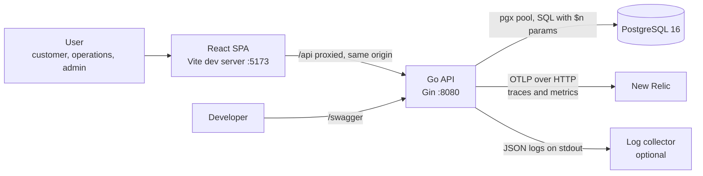
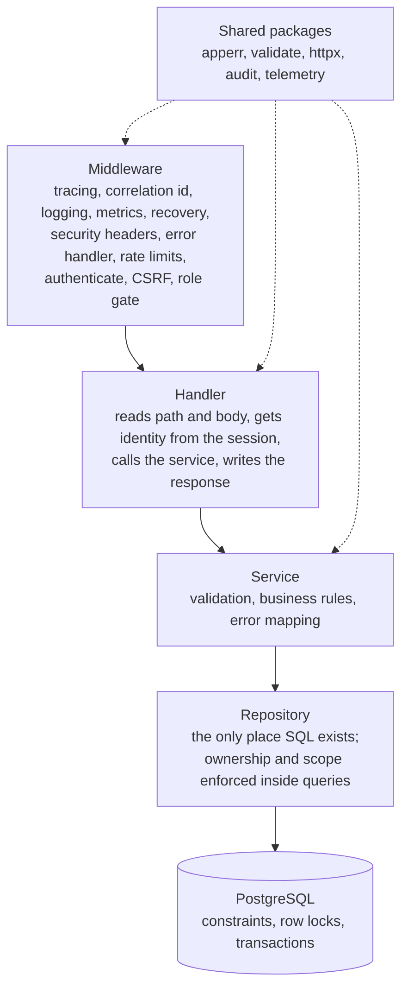
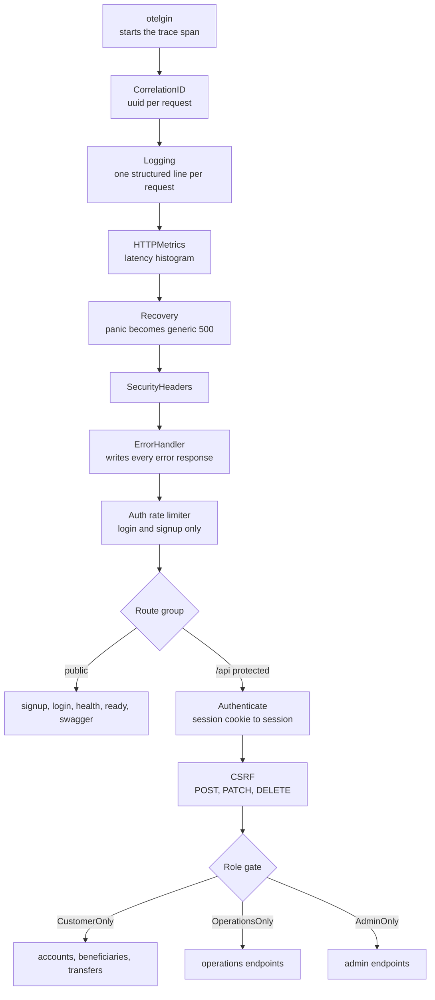
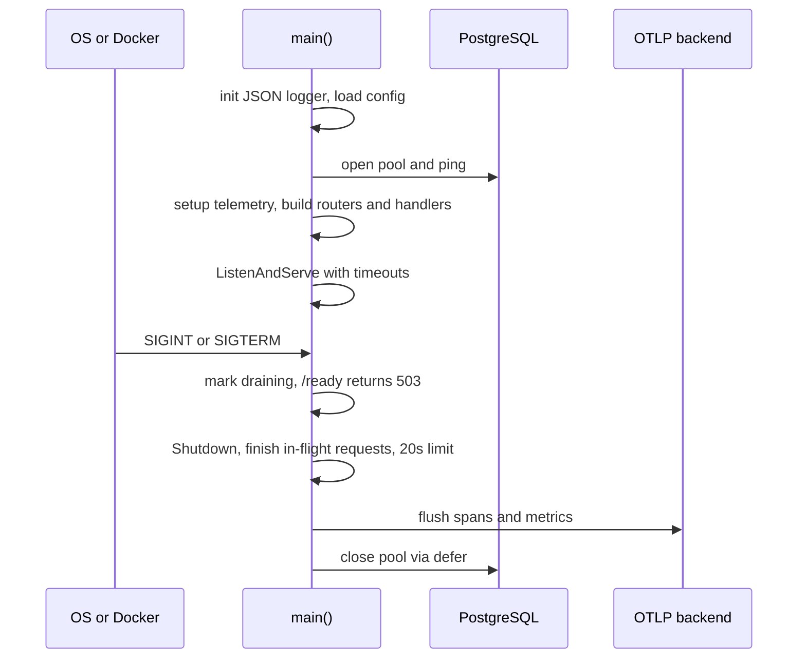

# Architecture

## 1. System context



The browser only talks to the frontend origin. In development Vite proxies `/api` to the backend, so
the browser makes no cross-origin calls and the API needs no CORS configuration.

## 2. Layers



| Layer | Does | Never does |
|---|---|---|
| Middleware | Cross-cutting concerns: identity, CSRF, rate limits, headers, logging, errors | Business rules |
| Handler | Parse input, call service, shape output | SQL, business decisions |
| Service | Validate, apply rules, translate repository errors into safe API errors | Touch `gin.Context`, write HTTP |
| Repository | Parameterised SQL, transactions, row locks | Decide permissions in Go code after the fact |

Rule of thumb: **ownership is checked inside the SQL** (`WHERE ... AND customer_id = $n`), so a request for
someone else's object finds no row and returns the same 404 as a missing object.

## 3. Middleware chain

Global middleware runs in this order (registered in `cmd/server/main.go`):



`POST /api/transfers` additionally passes a per-user transfer rate limiter. Tracing is first so every later
layer runs inside the span; metrics sit before Recovery so a panic still records as a 500.

## 4. Request lifecycle

```mermaid
sequenceDiagram
    participant C as Client
    participant M as Middleware
    participant H as Handler
    participant S as Service
    participant R as Repository
    participant D as PostgreSQL
    participant E as ErrorHandler

    C->>M: HTTP request with session cookie
    M->>M: authenticate, CSRF, role gate
    M->>H: request with session in context
    H->>H: strict JSON bind
    H->>S: call with typed input and user id
    S->>S: clean and validate input
    S->>R: query
    R->>D: SQL with placeholders
    D-->>R: rows or error
    R-->>S: record or sentinel error
    S-->>H: DTO or apperr
    alt success
        H-->>C: 2xx data and meta.correlationId
    else failure
        H->>E: httpx.Fail(err)
        E-->>C: generic error, correlationId; real cause logged only
    end
```

## 5. Startup and shutdown



Order matters: stop new traffic, finish in-flight work while the database is still open, flush telemetry,
then close the pool. Closing the pool first would break transfers midway.

## 6. Package map

| Package | Responsibility |
|---|---|
| `cmd/server` | Wiring, routes, HTTP server, graceful shutdown |
| `config` | Environment parsing and validation (rejects unsafe `TRUSTED_PROXIES`) |
| `database` | pgx pool with OpenTelemetry tracer and pool stats |
| `internal/auth` | Signup, login, logout, sessions, Argon2id, CSRF token generation |
| `internal/account` | Customer accounts and statement filters |
| `internal/beneficiary` | Beneficiary create, list, activate and deactivate |
| `internal/transfer` | Transfer creation, lookup, listing, reference numbers |
| `internal/operations` | Assignment-scoped accounts, transactions, transfers, review, freeze |
| `internal/admin` | Users, roles, status, password reset, assignments, limit, audit search |
| `internal/audit` | Best-effort audit writer plus metric counter |
| `internal/apperr` | Typed errors: code, status, safe message, hidden cause |
| `internal/httpx` | Strict JSON binding, session accessor, response helpers |
| `internal/validate` | Sanitising and allow-list validators, money parsing |
| `internal/telemetry` | Logger, OTLP setup, metrics |
| `internal/middleware` | All middleware listed above |
| `repository` | All SQL; one file per aggregate |

## 7. Frontend structure

```
frontend/src/
  api.js            fetch wrapper: sends cookie and X-CSRF-Token, surfaces backend error + correlation id
  auth.jsx          session context (login, logout, current user, csrf token)
  App.jsx           routes guarded by role
  components/       Layout, Transactions table, shared UI
  pages/customer/   Dashboard, AccountDetail, Beneficiaries, SendMoney, Transfers, TransferDetail
  pages/ops/        OpsAccounts, OpsAccountDetail, OpsTransfers
  pages/admin/      AdminUsers, AdminAssignments, AdminLimit, AdminAudit
```

The UI never decides access. It reflects what the backend allows, and every screen displays real backend
errors (with their correlation id) rather than hiding them.

## 8. Related documents

Design reasoning: [SYSTEM_DESIGN.md](SYSTEM_DESIGN.md). Data model: [DATABASE.md](DATABASE.md).
Transfer internals: [TRANSFER_LIFECYCLE.md](TRANSFER_LIFECYCLE.md). Telemetry: [OBSERVABILITY.md](OBSERVABILITY.md).