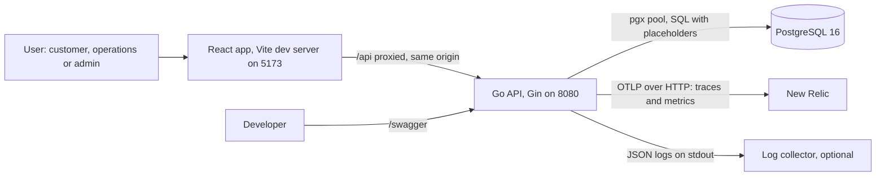
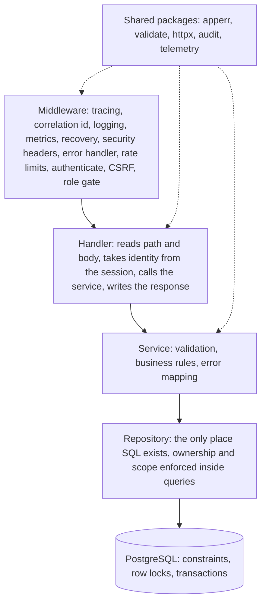
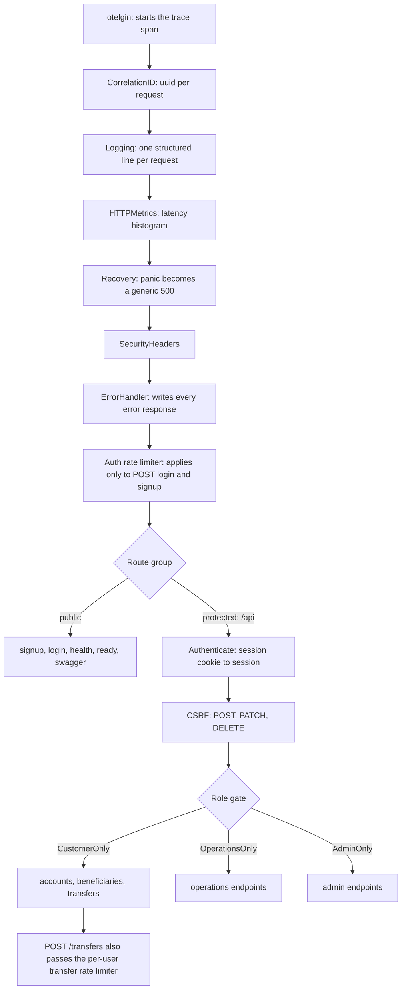
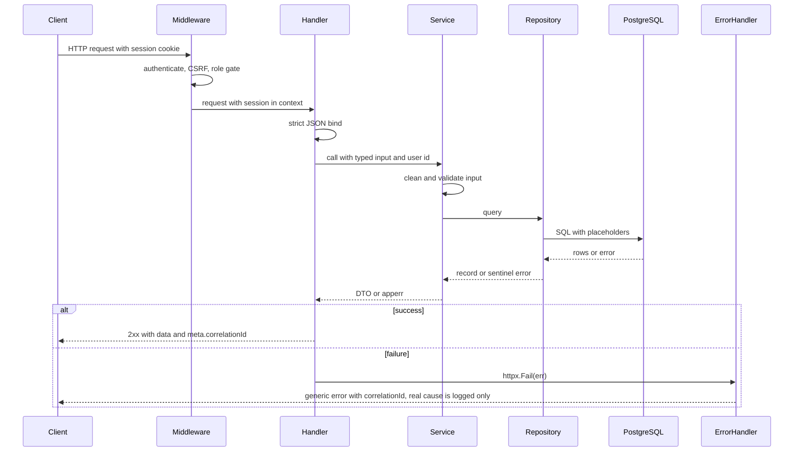
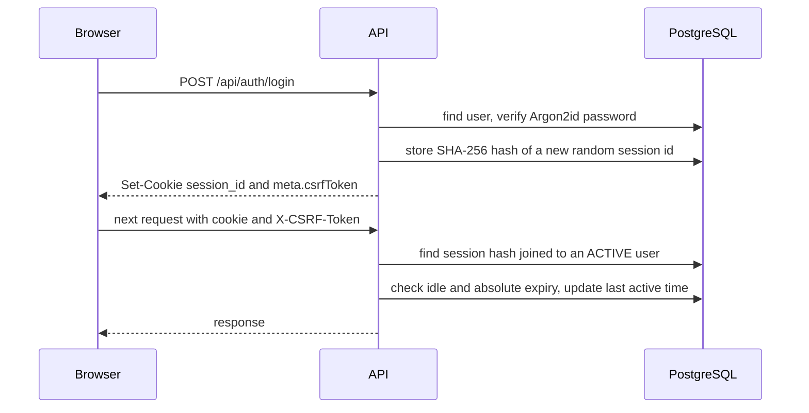
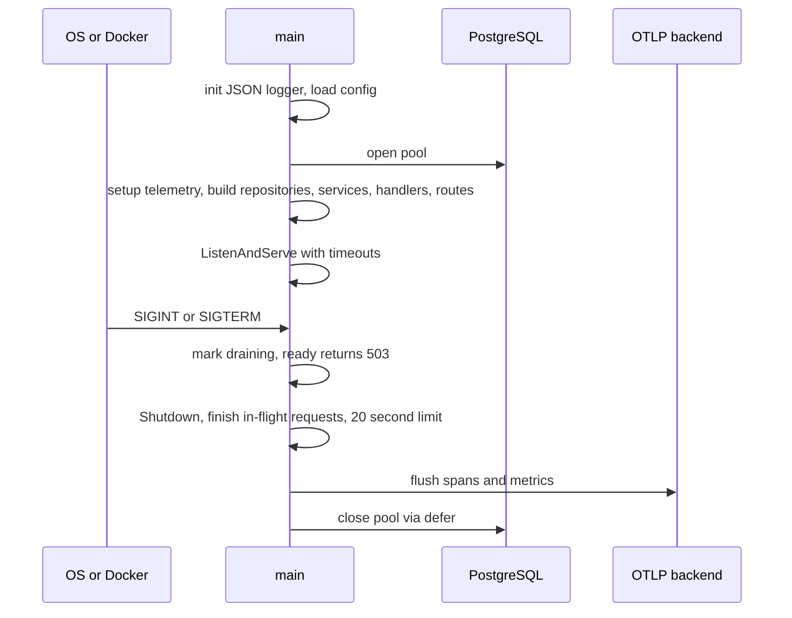
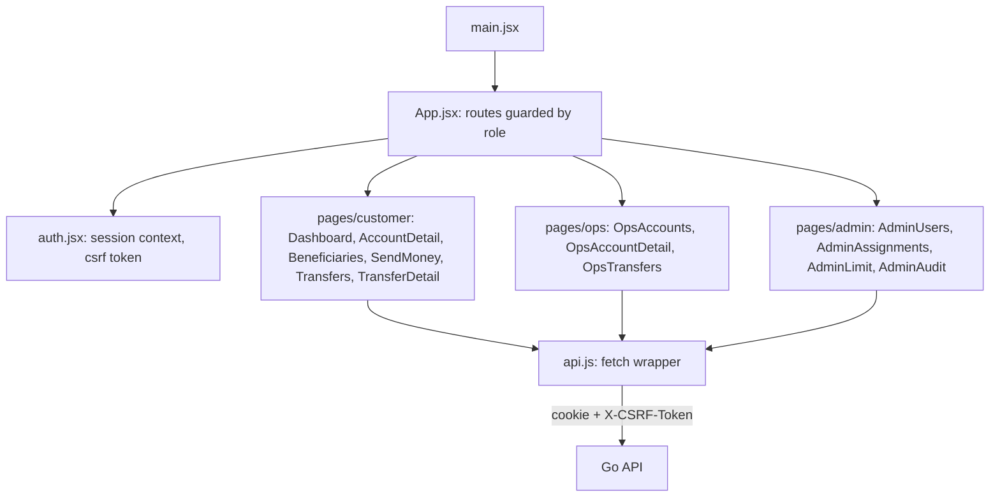

# Architecture

> **In one minute:** A React app talks to a Go API, and the API talks to PostgreSQL. Every request passes through the same middleware chain, then handler, service and repository. All SQL lives in repositories, and ownership checks happen inside that SQL.

Related: [design.md](design.md) (why), [database.md](database.md) (data), [transfer_lifecycle.md](transfer_lifecycle.md) (money flow), [observability.md](observability.md) (telemetry).

## 1. System context

The browser only talks to the frontend origin. In development Vite proxies `/api` to the backend, so the browser makes no cross-origin calls and the API needs no CORS configuration. In production a reverse proxy does the same job.

## 2. Layers

| Layer | Does | Never does |
|---|---|---|
| Middleware | Cross-cutting concerns: identity, CSRF, rate limits, headers, logging, errors | Business rules |
| Handler | Parse input, call service, shape output, record some audit events | SQL, business decisions |
| Service | Validate, apply rules, translate repository errors into safe API errors | Touch `gin.Context`, write HTTP |
| Repository | Parameterised SQL, transactions, row locks | Decide permissions in Go after the fact |

Rule of thumb: **ownership is checked inside the SQL** (`WHERE ... AND customer_id = $n`). A request for someone else's object finds no row and returns the same 404 as a missing object.

## 3. Middleware chain

Global middleware runs in this order (registered in `cmd/server/main.go`):

Notes:
- Tracing is first so every later layer runs inside the span. Metrics sit before Recovery so a panic still records as a 500.
- `GET /api/transfers/{referenceNumber}` is in the protected group but **not** inside a role group. Its handler allows `CUSTOMER` (own transfers) and `OPERATIONS` (assigned scope) and returns `403` for any other role.
- `/health`, `/ready` and `/swagger` are registered outside the protected group, so they need no session.

## 4. Request lifecycle

## 5. Authentication and sessions

Deactivation, role change and password reset delete the user's sessions, so access is revoked immediately.

## 6. Startup and shutdown

Order matters: stop new traffic, finish in-flight work while the database is still open, flush telemetry, then close the pool. Closing the pool first would break transfers midway.

## 7. Package map

| Package | Responsibility |
|---|---|
| `cmd/server` | Wiring, routes, HTTP server, graceful shutdown |
| `cmd/hashpw` | Small tool that prints an Argon2id hash for a password |
| `config` | Environment parsing and validation (rejects unsafe `TRUSTED_PROXIES`) |
| `database` | pgx pool with OpenTelemetry tracer |
| `internal/auth` | Signup, login, logout, sessions, Argon2id, CSRF token generation |
| `internal/account` | Customer accounts and statement filters |
| `internal/beneficiary` | Beneficiary create, list, activate and deactivate |
| `internal/transfer` | Transfer creation, lookup, listing, reference numbers |
| `internal/operations` | Assignment-scoped accounts, transactions, transfers, review, freeze |
| `internal/admin` | Users, roles, status, password reset, assignments, limit, audit search |
| `internal/audit` | Best-effort audit writer plus metric counter |
| `internal/apperr` | Typed errors: code, status, safe message, hidden cause |
| `internal/httpx` | Strict JSON binding, session accessor, response helpers |
| `internal/validate` | Sanitising and allow-list validators, money parsing |
| `internal/telemetry` | Logger, OTLP setup, metrics |
| `internal/middleware` | All middleware listed above |
| `repository` | All SQL, one file per aggregate |
| `internal/transaction`, `internal/user` | Empty placeholder packages, reserved for later |

## 8. Frontend structure

The frontend is JavaScript (`.jsx`), React 18 with Tailwind CSS. `components/` holds Layout, the Transactions table and shared UI. `format.js` formats money and dates.

The UI never decides access. It reflects what the backend allows, and every screen shows real backend errors with their correlation id instead of hiding them.
