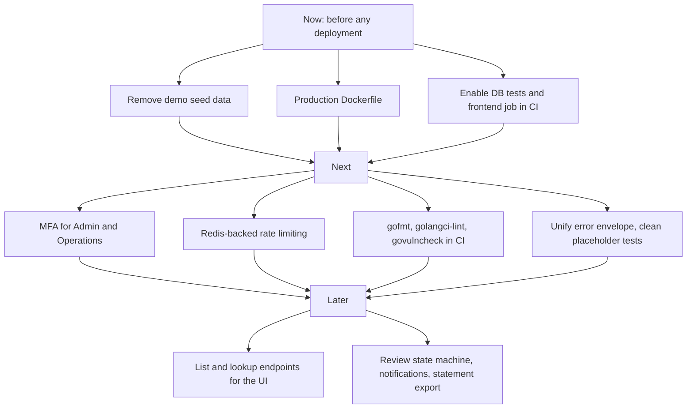

# Changelog and Status

> **In one minute:** The application features are built and tested. What remains is production hardening (remove demo data, MFA, shared rate limiting), CI gaps, and some cleanup of empty files and outdated notes.

## 1. Status at a glance

```mermaid
flowchart LR
    subgraph DONE["Done"]
        A1["Auth, sessions, CSRF"]
        A2["Customer: accounts, statements, beneficiaries"]
        A3["Transfers: atomic, idempotent, limited"]
        A4["Operations: review, freeze, assigned scope"]
        A5["Admin: users, assignments, limit, audit"]
        A6["Frontend for all three roles"]
        A7["Observability, Swagger, CI"]
        A8["Documentation set"]
    end
    subgraph TODO["Not done"]
        B1["Remove demo seed data"]
        B2["MFA and lockout"]
        B3["Shared rate limiting"]
        B4["DB tests and frontend in CI"]
        B5["Production Dockerfile"]
    end
    DONE --> TODO
```

| Area | State |
|---|---|
| Signup, login, logout, session expiry, CSRF | Done |
| Customer accounts, statements (filters, paging), beneficiaries | Done |
| Internal transfers (atomic, idempotent, limit, rate limit) | Done |
| Operations: assigned accounts, transactions, transfer review, freeze/unfreeze | Done |
| Admin: create users, status, role, reset password, assignments, limit, audit search | Done |
| Frontend: customer, operations, admin screens | Done |
| Observability: JSON logs, correlation ids, traces, metrics, health, graceful shutdown | Done |
| OpenAPI generated from annotations | Done |
| CI: vet, build, migrations, race tests, rollback round trip | Done |
| Production hardening | Not done |

## 2. Changelog

### Unreleased
- Added remaining documentation: transfer lifecycle, security, tests, observability, workflow, deployment, status.

### 1.0.0 (initial)
- Schema and seed data (`001_init`); admin-configurable transfer limit (`002_create_transaction_limits`).
- Go API: Gin, pgx (raw SQL), Argon2id, session cookies with HMAC CSRF tokens.
- Per-user idempotent transfers with ordered row locking, ledger and statement rows, audit events.
- Login, signup and transfer rate limiting.
- OpenTelemetry traces and metrics with New Relic via OTLP.
- React, Vite and Tailwind frontend with Vitest tests.

## 3. Known issues

### Code and tooling

| Item | Detail |
|---|---|
| Error envelope | Auth, CSRF and rate-limit middleware (and auth handlers) put `correlationId` under `meta`; everything else puts it inside `error`. [API.md](api.md) documents this. Fix by unifying in `ErrorHandler` |
| Placeholder files | `internal/transaction/*`, `internal/transfer/idempotency.go`, and about 20 files under `backend/tests/` contain only a `package` line |
| DB-backed tests skipped in CI | CI does not set `TEST_DATABASE_URL` |
| Frontend not in CI | No install, build or test step |
| Transfer `status` | `PENDING` and `FAILED` exist in the schema but are never written |
| Review transitions | Any change between `NONE`, `UNDER_REVIEW`, `RESOLVED` is accepted |
| `.dockerignore` empty | No production Dockerfile |
| `make test` | Runs without `-race` |

### Documentation to fix

| File | Issue |
|---|---|
| `README.md` | Says Gin 1.10; `go.mod` has Gin 1.12.0 and Go 1.26 |
| `README.md` | Documentation map links use upper-case names but the files are lower-case; keep the filenames exactly as listed |
| `api.md` | Says reset-password is "never logged or audited", but `USER_PASSWORD_RESET` is an audit event. Reword to "the password value is never logged or audited" |
| `.env.example` | `RATE_LIMIT` is unused; session timeouts differ from code defaults (`15m`/`8h` vs `30m`/`24h`) |
| `design.md` | Section 3.9 and the transfer flow are right, but add one line: `TRANSFER_FAILED` is a best-effort audit written by the handler **after** rollback, not inside the transaction |

## 4. Not implemented

- MFA and account lockout
- Shared (distributed) rate limiting
- External transfers; only internal account-to-account
- Customer bank account creation (signup makes a login with no account)
- List-users, all-accounts and recipient-lookup endpoints (the UI uses pasted ids)
- Notifications, scheduled transfers, statement export
- Load tests and browser end-to-end tests

## 5. Roadmap

## 6. Team

| Name | Contribution |
|---|---|
| [Guruprakash P](https://www.github.com/05-guruprakash) | Admin side, error handling, validation, observability  |
| [Harshatha Rithika](https://www.github.com/harshatha-exe) | Customer features, operations, backend integration and testing |
| [Dushyanth Raj V](https://www.github.com/vdushyanthraj) | Frontend (React) |
