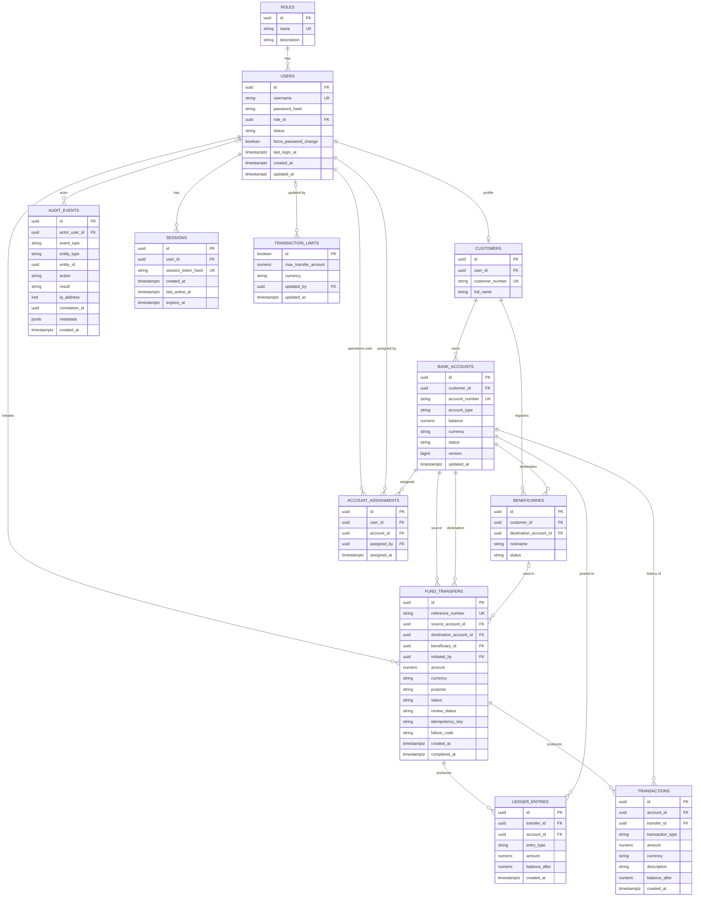
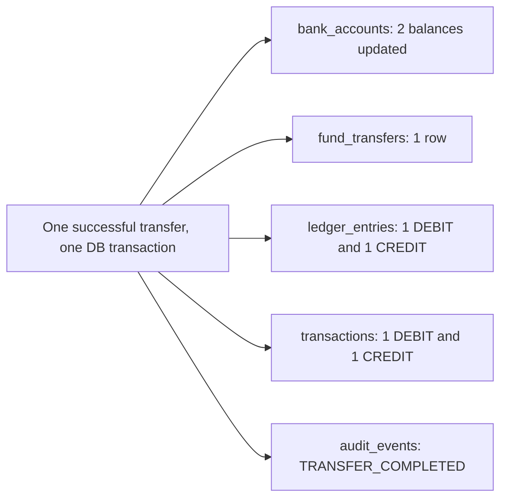

# Database

> **In one minute:** PostgreSQL 16 holds users, accounts, transfers, a ledger, statement lines, sessions and the audit log. The database itself refuses bad data (negative balances, duplicate transfers, invalid statuses), even if application code has a bug.

PostgreSQL 16. Schema versioned with [golang-migrate](https://github.com/golang-migrate/migrate) in `backend/migrations/`. Primary keys are UUIDs (`gen_random_uuid()` from `pgcrypto`). Timestamps are `TIMESTAMPTZ`. Money is `NUMERIC(19,2)`.

## 1. Entity relationship diagram



Allowed values (enforced by `CHECK`): role `CUSTOMER`, `OPERATIONS`, `ADMIN`; user and beneficiary status `ACTIVE`, `DEACTIVATED`; account type `SAVINGS`, `CURRENT`; account status `ACTIVE`, `FROZEN`; transfer status `PENDING`, `COMPLETED`, `FAILED`; review status `NONE`, `UNDER_REVIEW`, `RESOLVED`; entry type `DEBIT`, `CREDIT`; currency `INR`.

## 2. Tables

| Table | Purpose |
|---|---|
| `roles` | The three roles, seeded |
| `users` | Login identity, Argon2id hash, role, status, `force_password_change` flag |
| `customers` | Customer profile (1:1 with a customer user) |
| `bank_accounts` | Balance, status, type. `version` is incremented on each balance change |
| `beneficiaries` | A customer's saved destination account (the customer does not own it) |
| `account_assignments` | Which operations user may access which account |
| `fund_transfers` | One row per completed transfer, with review status and idempotency key |
| `ledger_entries` | Double-entry style rows: one DEBIT and one CREDIT per transfer. Append-only by convention (the code never updates or deletes them) |
| `transactions` | Customer-facing statement lines |
| `audit_events` | Who did what, with entity, result, IP, correlation id and metadata |
| `sessions` | Server-side sessions keyed by the hash of the cookie value |
| `transaction_limits` | Single-row configurable transfer limit |

## 3. What one transfer writes



All five commit together or none do. See [transfer_lifecycle.md](transfer_lifecycle.md).

## 4. Constraints that protect money

| Constraint | Prevents |
|---|---|
| `bank_accounts.balance CHECK (balance >= 0)` | Negative balances |
| `amount CHECK (amount > 0)` on transfers, ledger and transactions | Zero or negative transfers |
| `CHECK (source_account_id <> destination_account_id)` | Transfers to the same account |
| `UNIQUE (initiated_by, idempotency_key)` | Duplicate transfers from retries |
| `UNIQUE (customer_id, destination_account_id)` on beneficiaries | Duplicate beneficiaries |
| `UNIQUE (user_id, account_id)` on assignments | Duplicate assignments |
| `CHECK` lists on every status and role column | Invalid enum values |
| `CHECK (currency = 'INR')` on accounts and limits | Unsupported currency |
| `transaction_limits.id BOOLEAN PRIMARY KEY CHECK (id)` | More than one limit row |
| `sessions.user_id ... ON DELETE CASCADE` | Orphan sessions |

## 5. Indexes

| Table | Indexes |
|---|---|
| `roles` | `name` |
| `users` | `username`, `role_id` |
| `customers` | `user_id` |
| `bank_accounts` | `customer_id`, `status` |
| `beneficiaries` | `customer_id` |
| `account_assignments` | `user_id`, `account_id` |
| `fund_transfers` | `source_account_id`, `destination_account_id`, `initiated_by`, `created_at` |
| `ledger_entries` | `transfer_id`, `(account_id, created_at)` |
| `transactions` | `(account_id, created_at)`, `transfer_id` |
| `audit_events` | `actor_user_id`, `(event_type, created_at)`, `correlation_id` |
| `sessions` | `session_token_hash`, `user_id`, `expires_at` |

## 6. Migrations

| File | Contents |
|---|---|
| `001_init.up.sql` / `.down.sql` | Extension, all tables, indexes, role seed, demo users, customers, accounts and sample transfers |
| `002_create_transaction_limits.up.sql` / `.down.sql` | Single-row limit table, seeded at `100000.00` |

Rules:
1. Never edit an applied migration. Add a new numbered pair.
2. Every `up` has a working `down`. CI runs `up`, `down -all`, `up` to prove it.
3. Use a unique, increasing numeric prefix (`003_...`). Two files with the same number make `migrate` fail.
4. Test destructive changes against a copy of the data first.

```sh
make migrate-up       # apply all
make migrate-down     # roll back one step
```

## 7. Seed data (development only)

Four users (admin, operations, two customers), two customers with four accounts, and two completed sample transfers (`FT-DEMO-0001`, `FT-DEMO-0002`) with matching ledger and statement rows. The seeded `account_number` values are already masked-looking strings (`******1234`), and the API masks on output anyway.

Remove all of this before any real deployment ([deployment.md](deployment.md)).

## 8. Known schema notes

- `fund_transfers.status` allows `PENDING` and `FAILED`, and `failure_code` exists, but the current code only writes `COMPLETED` rows. Failed attempts are recorded as `TRANSFER_FAILED` audit events instead.
- `users.force_password_change` is set when an admin creates a user.
- `bank_accounts.version` is bumped on balance changes, but the code relies on row locks, not on version checks.

## 9. Querying notes

- Reads list columns explicitly instead of `SELECT *`.
- `balance` and `amount` are cast with `::text` on read so the API returns exact decimal strings.
- Dynamic filters (audit, statements, operations transfers) append constant SQL fragments with `$n` placeholders. Sort columns come from a lookup map, never from user input.
