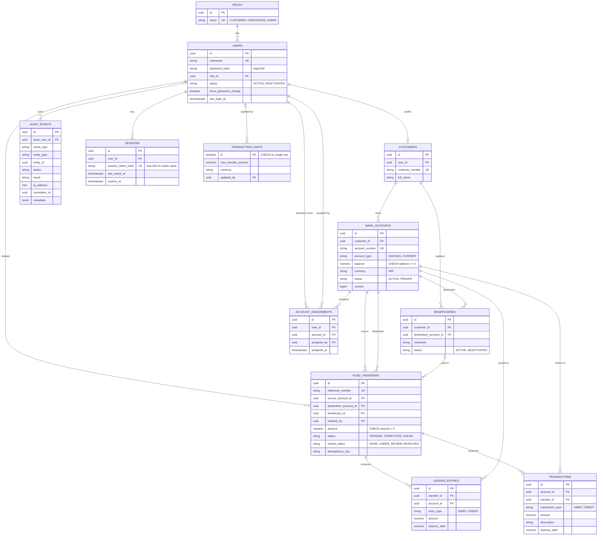

# Database

PostgreSQL 16. Schema versioned with [golang-migrate](https://github.com/golang-migrate/migrate) in
`backend/migrations/`. Primary keys are UUIDs (`gen_random_uuid()` from `pgcrypto`). Timestamps are `TIMESTAMPTZ`.

## 1. Entity relationship diagram



## 2. Tables

| Table | Purpose |
|---|---|
| `roles` | The three roles, seeded |
| `users` | Login identity, Argon2id hash, role, status |
| `customers` | Customer profile (1:1 with a customer user) |
| `bank_accounts` | Balance, status, type; `version` incremented on each balance or status change |
| `beneficiaries` | A customer's authorisation to use a destination account (does not own it) |
| `account_assignments` | Which operations user may access which account |
| `fund_transfers` | One row per transfer, with status, review status and idempotency key |
| `ledger_entries` | Immutable double-entry style rows (one DEBIT, one CREDIT per transfer) |
| `transactions` | Customer-facing statement rows |
| `audit_events` | Who did what, with entity, result, IP, correlation id, metadata |
| `sessions` | Server-side sessions keyed by hash of the cookie value |
| `transaction_limits` | Single-row configurable transfer limit |

## 3. Constraints that protect money

The database enforces the invariants even if application code has a bug:

| Constraint | Prevents |
|---|---|
| `bank_accounts.balance CHECK (balance >= 0)` | Negative balances |
| `fund_transfers.amount CHECK (amount > 0)`, same on ledger and transactions | Zero or negative transfers |
| `CHECK (source_account_id <> destination_account_id)` | Transfers to the same account |
| `UNIQUE (initiated_by, idempotency_key)` | Duplicate transfers from retries |
| `UNIQUE (customer_id, destination_account_id)` on beneficiaries | Duplicate beneficiaries |
| `UNIQUE (user_id, account_id)` on assignments | Duplicate assignments |
| `CHECK` lists on every status and role column | Invalid enum values |
| `CHECK (currency = 'INR')` | Unsupported currency |
| `transaction_limits.id BOOLEAN PRIMARY KEY CHECK (id)` | More than one limit row |
| `sessions.user_id ... ON DELETE CASCADE` | Orphan sessions |

## 4. Indexes

On foreign keys and hot paths: `users(username)`, `users(role_id)`, `sessions(session_token_hash)`,
`sessions(user_id)`, `sessions(expires_at)`, `bank_accounts(customer_id)`, `bank_accounts(status)`,
`transactions(account_id, created_at)`, `ledger_entries(account_id, created_at)`,
`fund_transfers(source_account_id)`, `fund_transfers(destination_account_id)`, `fund_transfers(initiated_by)`,
`fund_transfers(created_at)`, `audit_events(actor_user_id)`, `audit_events(event_type, created_at)`,
`audit_events(correlation_id)`.

## 5. Migrations

| File | Contents |
|---|---|
| `001_init.up/down.sql` | Extension, all tables, indexes, role seed, demo users, customers, accounts and sample transfers |
| `002_create_transaction_limits.up/down.sql` | Single-row limit table, seeded at 100000.00 |

Rules:
1. Never edit an applied migration. Add a new numbered pair.
2. Every `up` has a working `down`. CI runs `up`, `down -all`, `up` to prove it.
3. Use a unique, increasing numeric prefix (`003_...`). Two files with the same version number make `migrate` fail.
4. Test destructive changes against a copy of the data first.

```sh
make migrate-up       # apply all
make migrate-down     # roll back one step
```

## 6. Seed data (development only)

Four users (admin, operations, two customers), two customers with four accounts, and two completed sample transfers
with matching ledger and transaction rows. Account numbers in the seed are already masked-looking strings
(`******1234`); the API still masks on output, so real full numbers would be hidden too.

## 7. Querying notes

- Reads never use `SELECT *`; columns are listed explicitly.
- `balance` and `amount` are cast with `::text` on read so the API returns exact decimal strings.
- Dynamic filters (audit, statements, operations transfers) append constant SQL fragments with `$n` placeholders;
  sort columns come from a lookup map, not from user input.