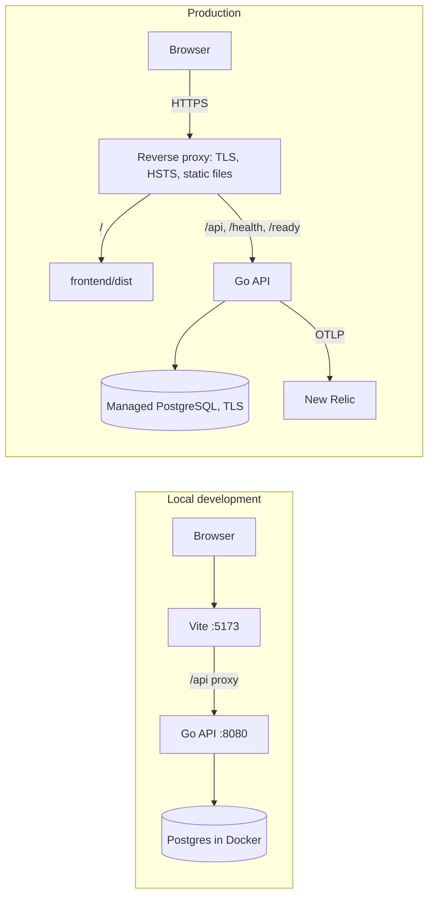
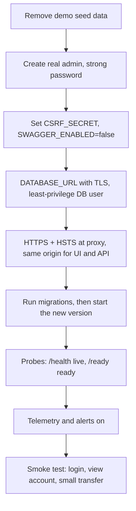

# Deployment

> **In one minute:** Locally you need Docker (for Postgres), the `migrate` CLI, Go and Node. For production you need HTTPS in front, a managed PostgreSQL, real secrets, and the demo users **removed**.

## 1. Run locally

```sh
cp -n .env.example .env
make db-up           # postgres:16-alpine on :5432, volume postgres-data
make migrate-up      # needs the golang-migrate CLI with the postgres driver
make run             # API on :8080 (reads ../.env)
```

```sh
cd frontend && npm install && npm run dev     # http://localhost:5173
```

The dev server proxies `/api` to `http://localhost:8080`. Use `VITE_API_TARGET=http://host:port npm run dev` to change it. Node 18 or newer. `backend/go.mod` declares a newer Go than the devcontainer image, so use a local Go that matches `go.mod`.

## 2. Local vs production



UI and API must share one origin: the backend has no CORS support and the session cookie is `Secure` + `SameSite=Strict`.

## 3. Configuration (`backend/config/config.go`)

A `.env` file is loaded if present.

| Variable | Required | Default | Notes |
|---|---|---|---|
| `DATABASE_URL` | yes | none | Use `sslmode=require` or stricter in production |
| `CSRF_SECRET` | yes | none | Long random value; signs CSRF tokens |
| `PORT` | no | `8080` | |
| `SESSION_IDLE_TIMEOUT` | no | `30m` | Go duration |
| `SESSION_MAX_LIFETIME` | no | `24h` | Go duration |
| `PASSWORD_MIN_LENGTH` | no | `12` | |
| `MAX_TRANSFER_AMOUNT_INR` | no | `100000` | Whole rupees. Fallback only; the live limit is the `transaction_limits` row |
| `TRUSTED_PROXIES` | no | empty | Comma-separated IPs or CIDRs; empty trusts none; `0.0.0.0/0` is rejected |
| `TRANSFER_RATE_LIMIT` | no | `10` | Transfers per user per minute |
| `SWAGGER_ENABLED` | no | `true` | Set `false` in production |
| `LOG_LEVEL` | no | `info` | `debug`, `info`, `warn`, `error` |
| `OTEL_*` | no | empty | See [OBSERVABILITY.md](observability.md); empty endpoint disables export |
| `POSTGRES_USER`, `POSTGRES_PASSWORD`, `POSTGRES_DB` | compose only | | Used by `docker-compose.yml` |

Notes:
- `.env.example` sets `SESSION_IDLE_TIMEOUT=15m` and `SESSION_MAX_LIFETIME=8h`; the code defaults are `30m` and `24h`.
- `RATE_LIMIT` in `.env.example` is a description only. The login limit (5 per minute) is fixed in `cmd/server/main.go`.

## 4. Build

```sh
cd backend && go build -o bin/server ./cmd/server
cd frontend && npm ci && npm run build        # static files in frontend/dist
```

There is no production Dockerfile yet (the CI image job is commented out). Serve `frontend/dist` from a static host or proxy and route `/api`, `/health`, `/ready` to the Go binary. Set `TRUSTED_PROXIES` to the proxy address.

To create a password hash for a real admin or operations user: `go run ./cmd/hashpw`.

## 5. Production checklist



**Security**
- [ ] Delete the demo users and their data from `001_init`: `demo-admin`, `demo-operations`, `demo-customer`, `demo-customer-b`, their customers, accounts, the two `FT-DEMO-*` transfers and related ledger and statement rows
- [ ] Create exactly one real administrator
- [ ] Long random `CSRF_SECRET`
- [ ] `SWAGGER_ENABLED=false`
- [ ] Secrets in a secret manager, not git

**Network**
- [ ] HTTPS only, HSTS added at the proxy
- [ ] `TRUSTED_PROXIES` set so rate limiting sees real client IPs
- [ ] Database port not public (compose publishes 5432 for local use only)

**Operations**
- [ ] Managed PostgreSQL 16, automated backups, tested restore
- [ ] Orchestrator grace period above 20 s (the shutdown timeout)
- [ ] OTLP endpoint and alerts configured
- [ ] Single API instance, or replace the in-memory rate limiter first ([SECURITY.md](security.md))

## 6. Rollback

1. Redeploy the previous binary and frontend build.
2. Only if the old version cannot run on the new schema: `migrate -path=backend/migrations -database "$DATABASE_URL" down 1`.
3. Check `/ready`, log in, open an account, run a small test transfer.