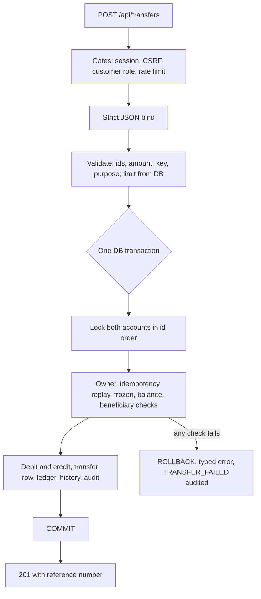

# System Design

## 1. Goals and non-goals

**Goals**
- Move money correctly: atomic, no double spend, no lost updates, no duplicates on retry.
- Enforce authorisation on the server for every object, not only by role.
- Make every sensitive action traceable (who, what, when, from where, which request).
- Reveal nothing useful to an attacker through errors, timing or logs.
- Be observable and shut down cleanly.

**Non-goals** (explicitly out of scope for this project)
- External payment rails, multi-currency, interest, statements as PDFs.
- Horizontal scaling beyond a single API instance (see section 8).
- Email or SMS notifications.

## 2. Requirements to design mapping

| Requirement | Design response |
|---|---|
| F1 Secure login | Argon2id, server-side sessions in PostgreSQL, HttpOnly + Secure + SameSite=Strict cookie, idle and absolute expiry, rate limits, generic failures, audited |
| F2 Account summary | Accounts read through the customer join; account numbers masked in the service layer |
| F3 Internal transfer | One DB transaction: lock, validate, debit, credit, ledger, history, audit, commit; idempotency key |
| F4 Beneficiaries | Ownership inside every query; insert-with-checks in a single statement |
| F5 Transaction history | Server-side pagination; sort and direction from fixed allow-lists |
| Freeze and review | Operations access limited by explicit account assignment, enforced inside SQL; audited |
| Admin | Single seeded admin, protected from API changes; every change audited in the same transaction |

## 3. Key design decisions

### 3.1 Layered architecture with SQL confined to repositories
Handlers, services and repositories each have one job ([ARCHITECTURE.md](ARCHITECTURE.md)). Confining SQL
to `repository/` means every query can be reviewed for injection and scope in one place, and services can be
unit tested with fakes.

### 3.2 pgx with raw SQL instead of an ORM
- Full control over locking (`FOR UPDATE`), `INSERT ... SELECT` with checks, and `RETURNING`.
- No hidden behaviour such as skipped zero values on updates.
- Trade-off: more SQL to write and review. Accepted, because the SQL is the security boundary.

### 3.3 Money is never a float
Amounts travel as decimal **strings** with two places (`"5000.00"`), are parsed into **integer paise**
(`validate.Money`: up to 15 integer digits, optional 1-2 decimals, no sign, no exponent), and are stored as
`NUMERIC(19,2)`. Arithmetic happens on integers; PostgreSQL casts back with `$n::numeric/100`.

### 3.4 Transfers are atomic, serialised per account, and idempotent
Detailed in [TRANSFER_LIFECYCLE.md](TRANSFER_LIFECYCLE.md). In short:
- Both accounts are locked with `ORDER BY id FOR UPDATE`. Locking in a consistent order prevents deadlocks when
  A to B and B to A run at the same time.
- The idempotency lookup runs **after** the locks, so two simultaneous requests with the same key serialise and
  the second one replays the first result instead of failing on the unique constraint.
- `UNIQUE (initiated_by, idempotency_key)` is the last line of defence.
- Debit, credit, transfer row, ledger rows, history rows and the audit event commit together or not at all.

### 3.5 Ownership and scope live inside SQL
Examples: `WHERE b.id = $1 AND b.customer_id = $2`; operations queries join `account_assignments` on the
caller's user id. A request for another user's object returns zero rows and the same `404` as a nonexistent one,
so existence is never leaked (BOLA/IDOR defence).

### 3.6 Sessions in PostgreSQL, not JWT
- The browser holds a random 256-bit id; the database stores only its SHA-256 hash (a database leak yields no
  usable sessions).
- Instant revocation: deactivation, role change and password reset delete the user's sessions.
- `sessions` is joined to `users` with `status = 'ACTIVE'` on every request.
- Trade-off: one DB read per request. Accepted for a bank-sized workload; revocation matters more than the read.

### 3.7 CSRF token derived by HMAC
Token = `HMAC-SHA256(CSRF_SECRET, session id)`. Nothing to store, bound to the session, compared in constant
time. Required on POST, PATCH and DELETE except login and signup. Defence in depth with `SameSite=Strict`.

### 3.8 Roles plus explicit assignment for operations
Role gates answer "what kind of user are you". Assignment rows answer "which accounts may you touch". The
administrator can assign but is not granted automatic access to customer financial data.

### 3.9 Audit trail written inside the transaction
Administrative changes insert their `audit_events` row through the same transaction as the change. There is
never a change without a record. Authentication and denial events use a best-effort writer that logs on failure
so auditing cannot take the service down.

### 3.10 Transfer limit stored in the database
`transaction_limits` is a single-row table (`CHECK (id)` on a boolean primary key). The admin API changes it with
an audit event. The transfer service reads it per request and **fails closed**: if the limit cannot be read, the
transfer is rejected. `MAX_TRANSFER_AMOUNT_INR` is only the fallback used when no provider is wired.

### 3.11 One error model
`apperr.Error` carries status, code, safe message, optional field messages and a hidden cause. Handlers call
`httpx.Fail`, and `ErrorHandler` is the single writer. Unknown errors become a generic 500. Field messages are
fixed strings, never echoed input or parser errors.

### 3.12 Observability as a first-class layer
Correlation id and trace id appear in logs, responses and audit rows. Metrics use **route templates** (not raw
URLs) to keep cardinality bounded. See [OBSERVABILITY.md](OBSERVABILITY.md).

## 4. Data flow: a transfer end to end

## 5. Failure modes

| Failure | Behaviour |
|---|---|
| Server crashes mid-transfer | Transaction never committed, nothing changes |
| Client retries after a timeout | Same `Idempotency-Key` returns the original result, one transfer exists |
| Two requests overdraw one account | Row lock serialises them; the second sees the reduced balance and fails with `INSUFFICIENT_FUNDS` |
| Database unreachable | `/ready` returns 503; requests fail with a generic 500 and an error log |
| Limit cannot be read | Transfer rejected (fail closed) |
| Audit write fails (non-transactional events) | Logged, request continues |
| Telemetry backend down | Batching exporters drop data; requests unaffected |
| SIGTERM during traffic | `/ready` flips to 503, in-flight requests finish (20 s max), telemetry flushes, pool closes |
| Panic in a handler | Recovered, logged, generic 500 with correlation id |

## 6. Concurrency summary

| Concern | Mechanism |
|---|---|
| Lost update on balances | `SELECT ... FOR UPDATE` in a transaction |
| Deadlock | Consistent lock order (`ORDER BY id`) |
| Duplicate submit | Idempotency key plus unique constraint |
| Concurrent admin edits | `FOR UPDATE OF u` on the user row |
| Rate limiter map | Mutex-protected, janitor goroutine, hard cap on tracked keys |

## 7. Security posture in one table

See [SECURITY.md](SECURITY.md) for the full threat-to-control map and known gaps.

## 8. Scaling and limits

| Area | Current | Consequence | Next step |
|---|---|---|---|
| API instances | One process | Fine for demo and exam scale | Stateless API already; scale out behind a load balancer |
| Rate limiter | In-memory per process | Limits are per instance | Move counters to Redis or enforce at the gateway |
| Sessions | PostgreSQL | One read per request | Cache with short TTL if needed |
| Pagination | OFFSET based, page capped | Deep pages are slower | Keyset pagination for statements |
| Audit table | Single table, indexed by actor, type, correlation id | Grows without bound | Partition by month, archive |
| Logs | stdout JSON | Needs a collector to centralise | Ship via the platform's log forwarder |

## 9. Assumptions

- Single currency (INR); destination accounts are internal.
- The administrator account is created only by seed data.
- Signup creates a customer without a bank account; accounts are provisioned out of band.
- TLS is terminated in front of the API in any real deployment (the session cookie is `Secure`).