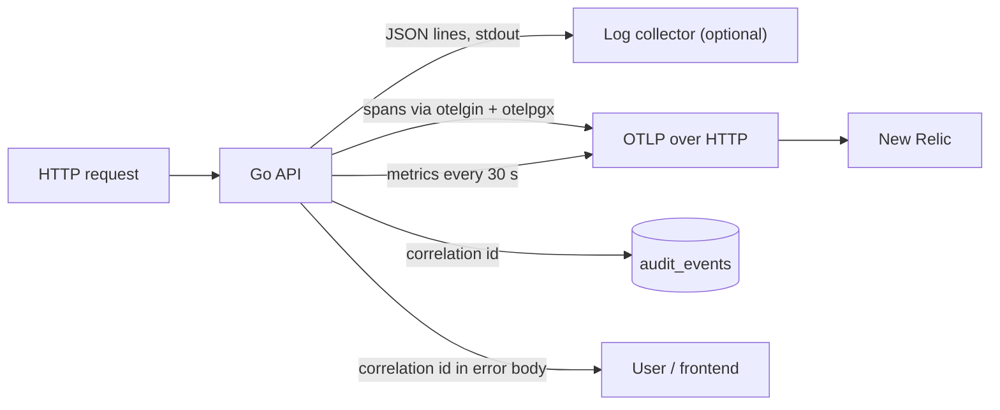
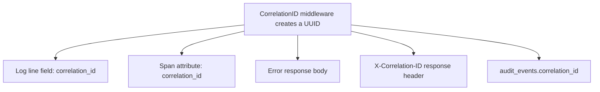
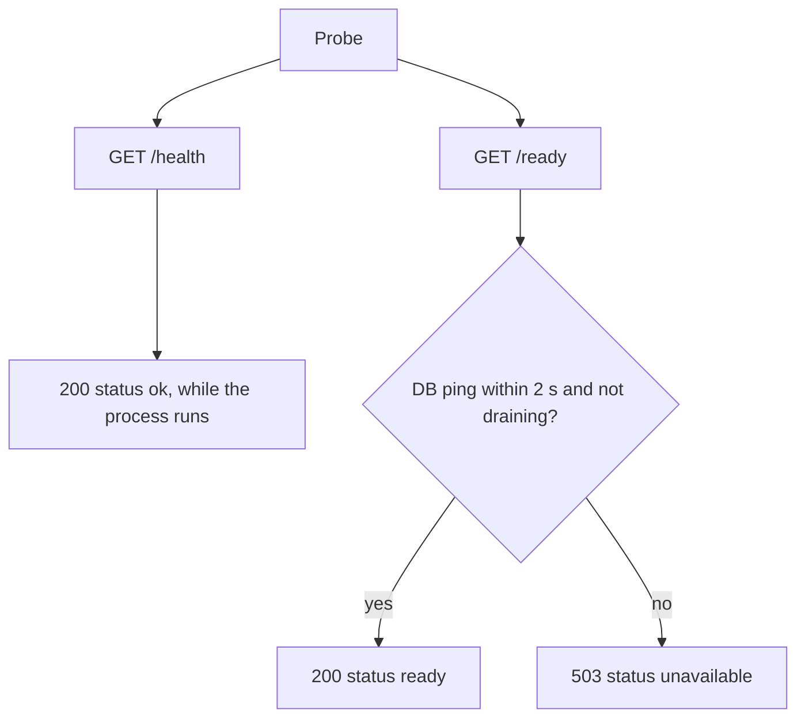
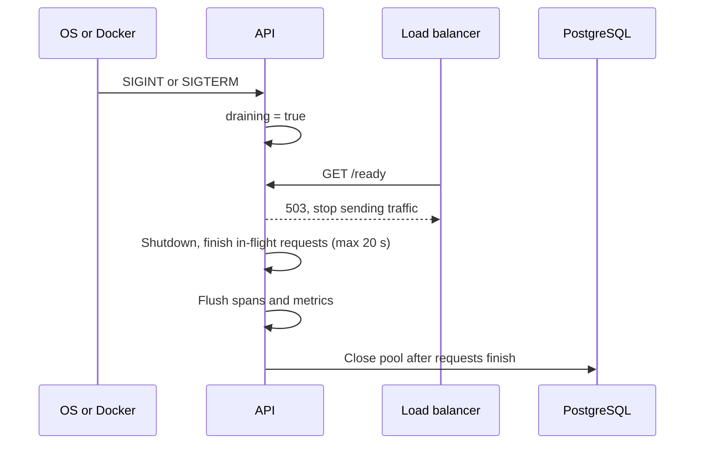

# Observability

> **In one minute:** The API writes JSON logs, sends traces and metrics to New Relic (or any OTLP backend), and tags every request with a **correlation ID**. Quote that ID from any error message to find the matching log line, trace and audit row.

Code: `internal/telemetry`, `internal/middleware/{correlation_id,logging}.go`, `cmd/server/main.go`.

## 1. How the signals flow



Export is a **no-op unless `OTEL_EXPORTER_OTLP_ENDPOINT` is set**, so local development needs nothing.

## 2. One ID to find everything



When a user reports an error, ask for the correlation ID. The frontend shows it next to backend errors.

## 3. Logging

- Level from `LOG_LEVEL` (`debug`, `info`, `warn`, `error`); empty or invalid means `info`.
- Standard `log` calls are routed through slog, so they also come out as JSON.
- Secrets are redacted by key: `password`, `token`, `secret`, `authorization`, `cookie`, `session_id`, `csrf_token`.
- One `request` line per call (probes `/health` and `/ready` are skipped). 5xx logs at `ERROR`, 4xx at `WARN`, the rest at `INFO`.

| Field | Meaning |
|---|---|
| `method`, `route`, `status`, `duration_ms` | `route` is the template (`/api/accounts/:accountId`), never the raw URL |
| `correlation_id` | Per-request id |
| `trace_id` | Present when a trace is active, links logs to traces |
| `client_ip` | Honors `TRUSTED_PROXIES` |
| `user_id`, `role` | Present when authenticated |

## 4. Traces

- `otelgin` creates one span per request (health and ready probes are filtered out).
- `otelpgx` adds one span per SQL statement under it, so slow queries show up inside their request.
- W3C trace context and baggage are propagated.
- Sampling uses the standard env vars `OTEL_TRACES_SAMPLER` and `OTEL_TRACES_SAMPLER_ARG`.

## 5. Metrics

| Metric | Type | Attributes |
|---|---|---|
| `http.server.request.duration` | histogram (seconds) | `http.request.method`, `http.route`, `http.response.status_code` |
| `bank.audit.events` | counter | `event_type`, `result` (logins, denials, rate limits) |
| `bank.transfers` | counter | `result` (`completed` or the failure code) |

Only route templates are used as attributes, which keeps the number of series bounded.

## 6. New Relic setup

Add to `.env` (see `.env.example`):

```sh
OTEL_SERVICE_NAME=bank-api
OTEL_EXPORTER_OTLP_ENDPOINT=<your New Relic OTLP endpoint>
OTEL_EXPORTER_OTLP_HEADERS=api-key=<NEW_RELIC_INGEST_LICENSE_KEY>
OTEL_EXPORTER_OTLP_PROTOCOL=http/protobuf
OTEL_EXPORTER_OTLP_METRICS_TEMPORALITY_PREFERENCE=delta
OTEL_TRACES_SAMPLER=parentbased_traceidratio
OTEL_TRACES_SAMPLER_ARG=0.1
```

Use the US or EU endpoint that matches your New Relic account. Never commit the key.

## 7. Health checks



```sh
curl -s localhost:8080/health
curl -s localhost:8080/ready
```

## 8. Graceful shutdown



Server timeouts: read header 5 s, read 10 s, write 15 s, idle 60 s.

## 9. Suggested alerts

- `/ready` failing for more than 1 minute
- 5xx rate above 2 percent for 5 minutes
- p95 request duration above 1 s
- Spike in `bank.audit.events` with `LOGIN_FAILURE` or `RATE_LIMITED`
- Rising `bank.transfers` failures