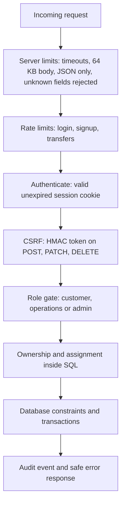
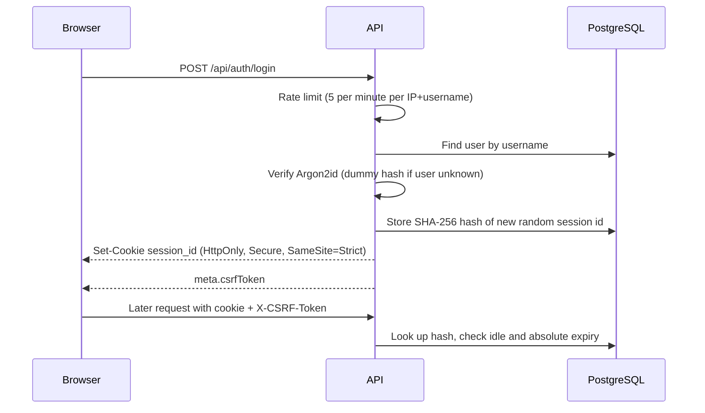
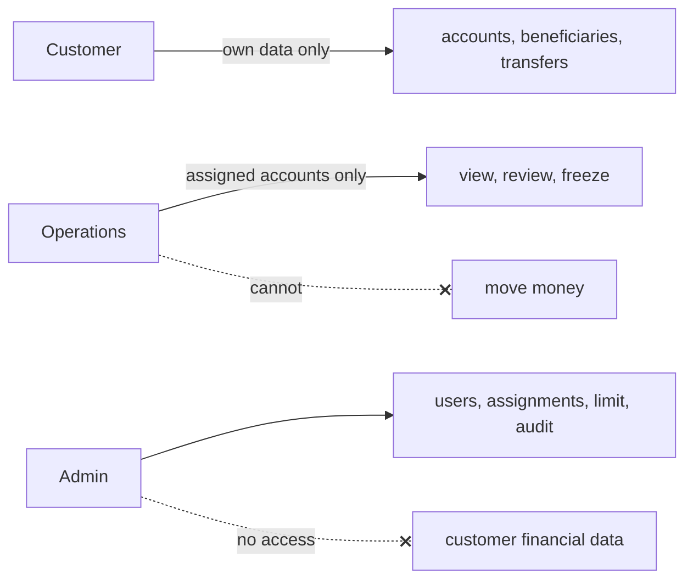

# Security

> **In one minute:** Every request passes through several gates (login session, CSRF token, role, then ownership checks inside SQL). Unknown and forbidden objects both return `404`, so attackers learn nothing. Money moves in one transaction, and sensitive actions are written to an audit log.

Related: [ARCHITECTURE.md](architecture.md), [SYSTEM_DESIGN.md](design.md), [TRANSFER_LIFECYCLE.md](transfer_lifecycle.md).

## 1. Defence in layers

A failure at any layer stops the request. The UI is never trusted to enforce anything.

## 2. Login and session

| Item | Implementation |
|---|---|
| Passwords | Argon2id, `m=65536 KiB, t=3, p=4`, 32-byte key, random salt |
| Password policy | At least `PASSWORD_MIN_LENGTH` (default 12) |
| Unknown user | Dummy hash is verified so response time does not reveal valid usernames |
| Failed login | Same `INVALID_CREDENTIALS` for unknown user, wrong password, deactivated user |
| Session id | 32 random bytes; only the SHA-256 hash is stored |
| Lifetimes | Idle `SESSION_IDLE_TIMEOUT` (default 30m), absolute `SESSION_MAX_LIFETIME` (default 24h) |
| Revocation | Logout, deactivation, role change and password reset delete the user's sessions |

The cookie is `Secure`, so browsers send it only over HTTPS or `localhost`.

## 3. CSRF

`middleware/csrf.go` requires `X-CSRF-Token` on every POST, PATCH and DELETE except login and signup. Token = `base64url(HMAC-SHA256(CSRF_SECRET, session_id))`, compared in constant time. Missing or wrong gives `403 CSRF_INVALID`.

## 4. Who can do what

| Layer | Control |
|---|---|
| Route groups | `CustomerOnly`, `OperationsOnly`, `AdminOnly`. Wrong role gets `403` and an `ACCESS_DENIED` audit event |
| Customer data | SQL is scoped to the caller's customer record |
| Operations data | SQL joins `account_assignments`; unassigned objects return `404` |
| Admin protections | `ADMIN` can never be granted; the admin cannot be deactivated, demoted or password-reset through the API (`PROTECTED_USER`, `INVALID_ROLE_CHANGE`) |

## 5. Rate limiting (`middleware/rate_limit.go`)

| Limiter | Key | Limit |
|---|---|---|
| Login | IP + username | 5 per minute |
| Login | IP | 20 per minute |
| Signup | IP | 5 per minute |
| Transfers | user | `TRANSFER_RATE_LIMIT` per minute (default 10) |

Over the limit: `429 RATE_LIMITED` with `Retry-After`, and a `RATE_LIMITED` audit event. Counters live in process memory (capped at 100,000 keys, a janitor removes old ones).

`TRUSTED_PROXIES` decides which proxy headers are believed for the client IP. Empty trusts none, and `0.0.0.0/0` is rejected at startup.

## 6. Input and output safety

- **SQL:** pgx parameterised queries only; all SQL lives in `backend/repository/`. Sort columns come from fixed maps.
- **Validation:** `internal/validate` (money, idempotency key, text cleaning, allow-lists).
- **JSON:** `httpx.BindJSON` requires `application/json` (415), caps the body at 64 KB (413), rejects unknown fields and trailing data (400).
- **Errors:** `apperr` + `httpx` give stable codes and safe messages. Real causes go to logs only.
- **Masking:** account numbers appear as `******1234`.
- **Headers:** `X-Content-Type-Options: nosniff`, `X-Frame-Options: DENY`, `Referrer-Policy: no-referrer`, CSP `default-src 'none'; frame-ancestors 'none'` (relaxed only under `/swagger/`).
- **Slowloris:** read-header 5 s, read 10 s, write 15 s, idle 60 s, 64 KB header cap.
- **Log redaction:** keys `password`, `token`, `secret`, `authorization`, `cookie`, `session_id`, `csrf_token` become `[REDACTED]`.

## 7. Audit trail

`audit_events` stores actor, event type, entity, action, result, IP, correlation id and metadata. Only the admin can search it (`GET /api/admin/audit-events`).

| How it is written | Events |
|---|---|
| **Inside the same transaction** as the change, so no change exists without a record | Admin changes (`USER_CREATED`, `USER_STATUS_CHANGED`, `USER_ROLE_CHANGED`, `USER_PASSWORD_RESET`, `ACCOUNT_ASSIGNED`, `TRANSACTION_LIMIT_CHANGED`), `TRANSFER_COMPLETED` |
| **Best effort** (failure is logged, request continues) | `LOGIN_SUCCESS`, `LOGIN_FAILURE`, `LOGOUT`, `ACCESS_DENIED`, `RATE_LIMITED`, `TRANSFER_FAILED`, `TRANSFER_REVIEWED`, `ACCOUNT_FROZEN`, `ACCOUNT_UNFROZEN`, beneficiary events |

Password values are never logged or stored in audit metadata.

## 8. Threat to control map

| Threat | Control |
|---|---|
| Brute force, credential stuffing | Login rate limits, Argon2id, audited failures |
| Username enumeration | Same error and similar timing for all failures |
| Session theft from a DB leak | Only session hashes stored |
| CSRF | Per-session HMAC token plus `SameSite=Strict` |
| BOLA / IDOR | Scope inside SQL, `404` on mismatch |
| Privilege escalation | Role gates, `ADMIN` cannot be granted, protected admin user |
| Double spend, races | One transaction, ordered row locks, `CHECK (balance >= 0)` |
| Duplicate submit | Per-user idempotency key |
| SQL injection | Parameterised queries, no string-built SQL |
| XSS | JSON API, strict CSP, React escaping |
| Slowloris and big bodies | Server timeouts, 64 KB cap |
| Secrets in logs | Redacting log handler |
| Spoofed client IP | `TRUSTED_PROXIES` allow-list |

## 9. OWASP API Security Top 10 (2023)

| # | Risk | Status |
|---|---|---|
| API1 | Broken object level authorization | Mitigated (scoped SQL; `TestAccountsBOLAAndTransactions`) |
| API2 | Broken authentication | Mitigated (Argon2id, expiry, rate limits). No MFA |
| API3 | Broken object property level authorization | Mitigated (response DTOs, masking) |
| API4 | Unrestricted resource consumption | Partly: rate limits, body caps, pagination (limits are in memory) |
| API5 | Broken function level authorization | Mitigated (role gates per route group) |
| API6 | Unrestricted access to sensitive flows | Mitigated (limit, per-user rate limit, idempotency) |
| API7 | SSRF | Not applicable (no outbound fetch from user input) |
| API8 | Security misconfiguration | Partly: Swagger defaults to on, demo seed data |
| API9 | Improper inventory management | Mitigated (OpenAPI generated from code, `swagger_test`) |
| API10 | Unsafe consumption of APIs | Not applicable (no third-party calls) |

## 10. Known gaps

| Gap | Risk | Fix |
|---|---|---|
| Demo users seeded in `001_init` | Known passwords in any deployed DB | Delete seed rows, create a real admin with `cmd/hashpw` |
| `SWAGGER_ENABLED` defaults to `true` | Larger public surface | Set `false` in production |
| Placeholder `CSRF_SECRET` in `.env.example` | Forgeable CSRF tokens if kept | Use a long random secret |
| Rate limits are per process | Bypassed by many instances or a restart | Redis or gateway limits |
| No MFA or account lockout | Targeted attacks | MFA for Admin and Operations |
| No HSTS from the app | Downgrade risk | Add at the reverse proxy |
| No CORS support | UI and API must share one origin | Keep `/api` behind one origin |
| No breached-password check | Weak long passwords accepted | Add a denylist |
| Lint and `govulncheck` jobs commented out in CI | Unscanned code and dependencies | Enable them |
| Some middleware errors put `correlationId` under `meta` instead of `error` | Inconsistent error shape | Unify in `ErrorHandler` |