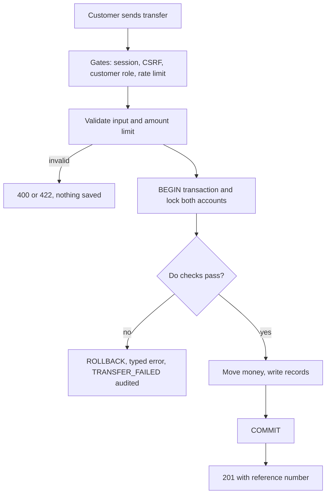
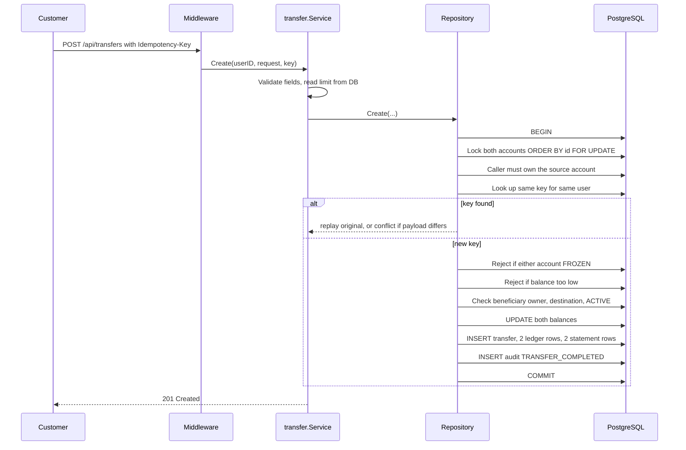
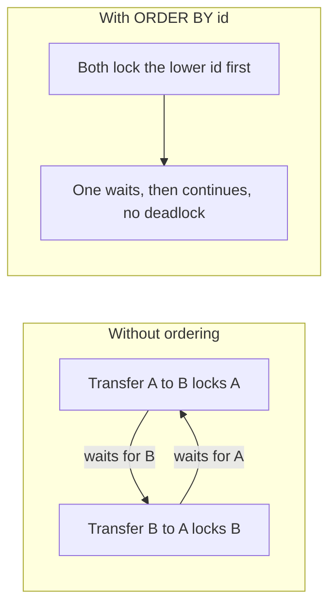
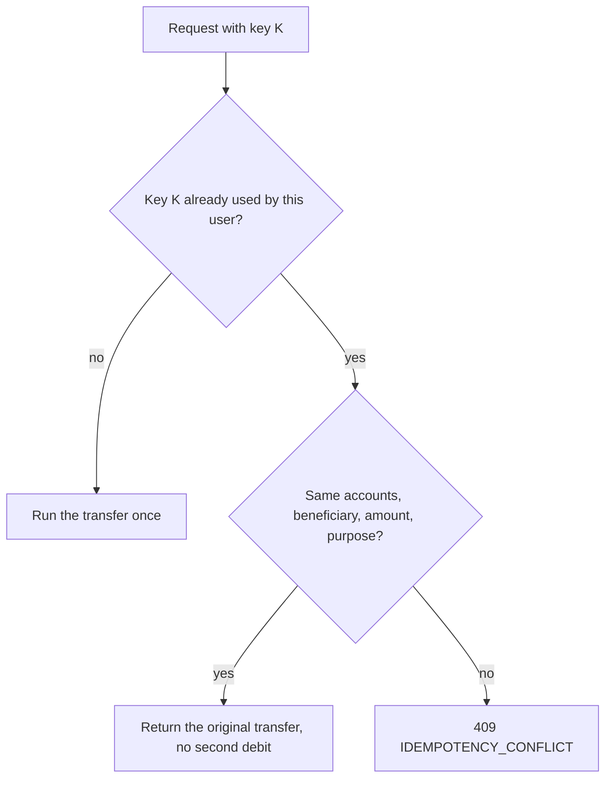
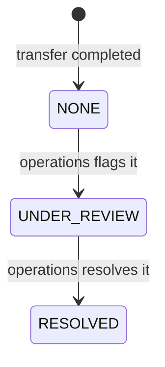
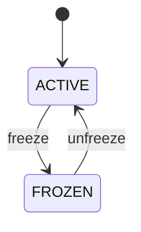

# Transfer Lifecycle

> **In one minute:** A transfer moves money between two accounts inside **one database transaction**. Either everything is saved (balances, ledger, statement, audit) or nothing is. A unique **Idempotency-Key** makes retries safe, and **row locks** stop two requests from spending the same money.

Code: `internal/transfer/service.go`, `repository/transfer_repository.go`. Related: [API.md](api.md), [DATABASE.md](database.md), [SECURITY.md](security.md).

## 1. The request

`POST /api/transfers` (Customer only). Needs the session cookie, `X-CSRF-Token`, and an `Idempotency-Key` header.

```json
{
  "sourceAccountId": "uuid",
  "destinationAccountId": "uuid",
  "beneficiaryId": "uuid (optional)",
  "amount": "1500.00",
  "purpose": "Rent (max 255 chars)"
}
```

Success: `201 Created` with the transfer (`referenceNumber` like `TRF-9F3A1C0B7D2E4A55`, `status: COMPLETED`, `reviewStatus: NONE`).

## 2. The big picture



## 3. Step by step



## 4. Rules and the error you get

Checked **before** the database (service layer):

| Rule | HTTP | Code |
|---|---|---|
| Source and destination present and different | 400 | `VALIDATION_ERROR` |
| Amount positive, at most 2 decimals | 400 | `VALIDATION_ERROR` |
| Idempotency key is 16-100 chars of `A-Z a-z 0-9 _ -` | 400 | `VALIDATION_ERROR` |
| Purpose at most 255 characters | 400 | `VALIDATION_ERROR` |
| Amount at most the admin limit | 422 | `TRANSFER_LIMIT_EXCEEDED` |

Checked **inside** the transaction (repository):

| Rule | HTTP | Code |
|---|---|---|
| Source account is yours (unknown or foreign looks the same) | 404 | `NOT_FOUND` |
| Same key, different payload | 409 | `IDEMPOTENCY_CONFLICT` |
| Source or destination is frozen | 422 | `ACCOUNT_FROZEN` |
| Source balance is enough | 422 | `INSUFFICIENT_FUNDS` |
| Beneficiary is yours, matches destination, is ACTIVE | 404 / 422 | `NOT_FOUND` / `BENEFICIARY_INACTIVE` |

Also possible: `403 CSRF_INVALID`, `429 RATE_LIMITED` (with `Retry-After`), `500 INTERNAL_ERROR`.

The limit is read from the `transaction_limits` table on every request. If it cannot be read, the transfer is **rejected** (fail closed). `MAX_TRANSFER_AMOUNT_INR` is only a fallback when no provider is wired.

Money is parsed into integer **paise** and stored as `NUMERIC(19,2)`. It is never a float.

## 5. Why locks and ordering matter



- Both accounts are locked with `ORDER BY id FOR UPDATE`, so opposite transfers never deadlock.
- Two requests on one account run one after another, so the balance can never go negative. The database also enforces `CHECK (balance >= 0)`.

## 6. Idempotency (safe retries)

Scope: per user, `UNIQUE (initiated_by, idempotency_key)`.



- The key lookup happens **after** the locks. Two simultaneous requests with the same key line up, and the second one replays the first result.
- The replay check runs before the frozen and balance checks, so retrying a completed transfer still works even if the account was frozen later.
- The frontend keeps the key in `sessionStorage` for about 10 minutes so a retry after a dropped connection reuses it.

## 7. What gets written on success (one commit)

| Table | Rows |
|---|---|
| `bank_accounts` | Both balances updated, `version + 1` |
| `fund_transfers` | 1 row, `COMPLETED`, review `NONE` |
| `ledger_entries` | 1 DEBIT and 1 CREDIT |
| `transactions` | 1 DEBIT and 1 CREDIT (statement lines) |
| `audit_events` | `TRANSFER_COMPLETED`, inside the same transaction |

On failure no `fund_transfers` row is written. The handler then records a `TRANSFER_FAILED` audit event with the reason, accounts and amount, plus a metric. That audit write is best effort and happens outside the transaction. The `status` column also allows `PENDING` and `FAILED`, but the code only ever creates `COMPLETED`.

## 8. Review lifecycle (Operations)

`PATCH /api/operations/transfers/{reference}/review` with `reviewStatus` = `UNDER_REVIEW` or `RESOLVED`.



- Only transfers touching an **assigned** account are visible; anything else is `404`.
- The row is locked while changing, and old and new values are audited (`TRANSFER_REVIEWED`, best effort).
- Review never changes balances. The service checks the target value only, so it does not enforce the order shown above.

## 9. Freeze lifecycle (Operations)

`POST /api/operations/accounts/{accountId}/freeze` and `/unfreeze`, assigned accounts only.



- Repeating the same request changes nothing and writes no audit event.
- While frozen, any transfer where the account is **source or destination** fails with `ACCOUNT_FROZEN`.
- Freezing does not reverse past transfers or hide the statement.

## 10. Reference numbers

`TRF-` plus 16 random hex characters (`crypto/rand`). Seeded demo transfers use `FT-DEMO-xxxx`. Look one up with `GET /api/transfers/{referenceNumber}`. Customers see only their own; operations users only within their assigned scope.