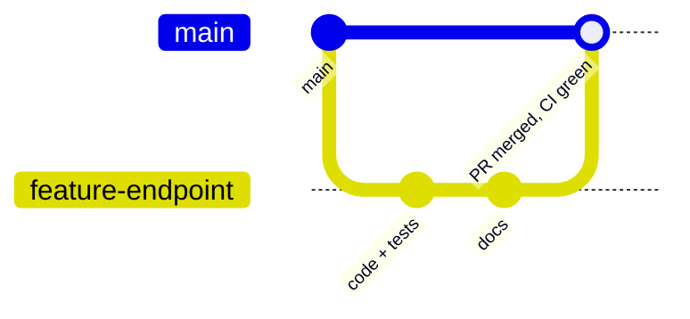
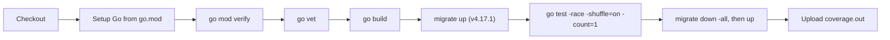
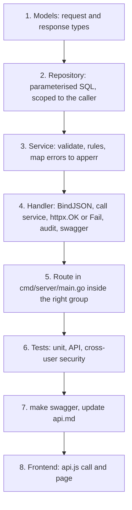
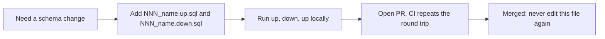

# Workflow

> **In one minute:** Branch, change, open a pull request, let CI check it, merge to `main`. To add an endpoint, work from the database up (repository, service, handler, route), then tests and docs.

## 1. Git flow



- `main` is the integration branch. CI runs on every push to `main` and on every pull request.
- Use short-lived branches (`feat/...`, `fix/...`, `docs/...`).
- A new push to the same branch cancels the older CI run.

## 2. CI pipeline (`.github/workflows/ci.yml`)



One job (`backend`) with a Postgres 16 service, 15 minute timeout and read-only token permissions.

Prepared but commented out: `gofmt` check, `golangci-lint`, `govulncheck`, production Docker image build. Not in CI at all: frontend install, build and tests.

If you add a required variable to `config.go`, add a throw-away value to the workflow's `env:` block.

## 3. Local development

```sh
cp -n .env.example .env
make db-up && make migrate-up && make run     # API on :8080
cd frontend && npm install && npm run dev      # UI on :5173, proxies /api to :8080
```

| Make target | Does |
|---|---|
| `make db-up` / `db-down` / `logs` | Start, stop, tail the Postgres container |
| `make migrate-up` / `migrate-down` | Apply all, or roll back one migration (needs the `migrate` CLI) |
| `make run` | Load `.env`, run `go run ./cmd/server` |
| `make test` | `go test ./...` in `backend` |
| `cd backend && make swagger` | Regenerate `backend/docs` from annotations |

A `.devcontainer` is provided (Go image, Docker-in-Docker, Node LTS; installs `migrate`, `swag`, `air`). Its ports and extensions still mention Angular and port 4200; remove them.

## 4. Pull request checklist

- [ ] `go vet ./...` and `go test -race ./...` pass
- [ ] New or changed endpoint has swagger annotations and `make swagger` was re-run
- [ ] Authorisation is enforced by the route group **and** by SQL scoping
- [ ] Sensitive actions write an audit event
- [ ] Migration added (and reversible) if the schema changed
- [ ] Tests added, including a negative authorisation case
- [ ] `docs/` updated (`api.md`, `database.md`, and any lifecycle or security page)
- [ ] No secrets, real data or new demo credentials committed

## 5. How to add an endpoint



Route groups in `main.go`: `protected` (auth + CSRF), then `customer`, `ops` or `adminRoutes`.

## 6. Migration rules



- Files live in `backend/migrations/` (golang-migrate). Use the next unused number.
- Every `up` has a working `down`.
- Money columns are `NUMERIC(19,2)`; keep `CHECK` constraints for invariants.
- No real credentials or personal data in seed data. `001_init` still holds demo users and must be cleaned before production ([DEPLOYMENT.md](deployment.md)).

## 7. Errors

Responses use `{ "error": { "code", "message", "correlationId" } }` ([API.md](api.md)). Create new codes through `apperr` (`BadRequest`, `Validation`, `Conflict`, `Unprocessable`, `NotFound`, `Forbidden`) and list them in the endpoint's swagger `@Failure` lines.